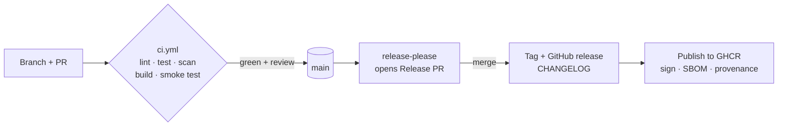

# Production repo template

[](https://github.com/codewithmuh/production-repo-template/actions/workflows/ci.yml)
[](https://github.com/codewithmuh/production-repo-template/actions/workflows/release.yml)
[](LICENSE)

A GitHub template that makes every new repository **production-grade from the first commit**: CI on every pull
request, secret and vulnerability scanning, signed container images with SBOMs, automated releases and changelog,
docs and runbooks, and a one-command local setup. It ships with two small sample services — one in **Python
(FastAPI)** and one in **Go** — so every pipeline runs against real code.

> Start a new project: click **Use this template** on GitHub, then follow [After creating a repo](#after-creating-a-repo-from-this-template).

---

## What you get

| Area | What is set up | Where |
|---|---|---|
| Code quality | ruff (lint + format), mypy strict, golangci-lint v2, pre-commit hooks | `pyproject.toml`, `.golangci.yml`, `.pre-commit-config.yaml` |
| Tests | pytest and Go tests with the race detector; **80 % coverage gate**; container smoke test | `tests/`, `*_test.go`, `ci.yml` |
| CI | Lint → test → build → scan → smoke test on every PR; workflows linted with actionlint | `.github/workflows/ci.yml` |
| Security | gitleaks, Trivy (repo + images), Actions pinned to SHAs, least-privilege tokens, non-root read-only containers | `ci.yml`, `Dockerfile`s, `SECURITY.md` |
| Supply chain | Images signed with cosign (keyless), SBOM (SPDX) on every release, build provenance | `release.yml` |
| Releases | Conventional Commits → release-please PR → tag, changelog, GHCR images | `release.yml`, `CHANGELOG.md` |
| Dependencies | Weekly grouped Dependabot PRs for Actions, uv, Go modules and base images | `.github/dependabot.yml` |
| Observability | JSON logs with request IDs, Prometheus metrics, liveness/readiness probes | `services/*` |
| Reliability | Graceful shutdown on SIGTERM, server timeouts, health checks in images | `services/*`, `compose.yaml` |
| Docs | Architecture, threat model, ADRs, runbooks, contributing, security policy, issue/PR templates | `docs/`, `.github/` |
| Developer experience | `make` targets, Dev Container, Docker Compose, `.env.example` | `Makefile`, `.devcontainer/` |

## Quick start

Requirements: [uv](https://docs.astral.sh/uv/), [Go 1.27](https://go.dev/dl/),
[golangci-lint](https://golangci-lint.run/), [pre-commit](https://pre-commit.com/), Docker — or just open the
**Dev Container**.

```bash
make setup    # install dependencies and git hooks
make check    # lint, type-check and test everything (same as CI)
make up       # run both services: python on :8000, go on :8080

curl localhost:8000/v1/hello?name=Tokyo   # {"message":"Hello, Tokyo!"}
curl localhost:8080/metrics | head

make down
```

Run `make` with no arguments to list every command.

## How changes flow



1. Open a pull request with a [Conventional Commit](https://www.conventionalcommits.org/) title.
2. `ci.yml` must pass and a code owner approves; squash-merge into `main`.
3. release-please keeps a Release PR open with the next version and changelog.
4. Merging the Release PR tags the version; `release.yml` publishes signed images to GHCR and attaches SBOMs.

## Repository layout

```
.github/                 workflows, Dependabot, CODEOWNERS, issue + PR templates
.devcontainer/           reproducible dev environment
docs/                    architecture, threat model, ADRs, runbooks
services/api-python/     FastAPI sample: src/, tests/, Dockerfile, pyproject.toml, uv.lock
services/api-go/         Go sample: cmd/, internal/, Dockerfile, go.mod
compose.yaml             local run with production-like hardening
Makefile                 every command you need
```

## Every service follows the same contract

| Endpoint / behaviour | Meaning |
|---|---|
| `GET /healthz` | Liveness — the process is up (never checks dependencies) |
| `GET /readyz` | Readiness — 503 until started and while shutting down |
| `GET /metrics` | Prometheus metrics: request count and latency by route and status |
| Logs | JSON on stdout, one line per request, with `request_id` (taken from `X-Request-Id` or generated) |
| `SIGTERM` | Fail readiness → finish in-flight requests (≤ 20 s) → exit |
| Image | Non-root user, read-only filesystem, built-in `HEALTHCHECK` |

## After creating a repo from this template

1. Replace `codewithmuh/production-repo-template` in `README.md`, `SECURITY.md`, `.github/CODEOWNERS` and
   `services/api-go/go.mod` with your repository.
2. Rename, replace or delete the sample services — keep the runtime contract above.
3. Protect `main` (Settings → Branches): require pull requests, one approval, and these status checks:
   `Repo checks (workflows, secrets, misconfigurations)`, `Python (lint, types, tests)`, `Go (lint, tests)`,
   and both `Image … (build, scan, smoke test)` jobs.
4. Settings → Actions → General: allow GitHub Actions to create pull requests (needed by release-please).
5. Settings → Code security: enable Dependabot alerts and private vulnerability reporting.
6. Use **squash merge** only, so each PR title becomes one Conventional Commit.
7. Fill in `docs/architecture.md` and write your first real ADR.

## Production-grade checklist

Use this before announcing a project built from the template.

- [ ] Code quality — linters, formatters, type checks and pre-commit pass
- [ ] Tests — unit + integration, ≥ 80 % coverage, a smoke test and a load test with published numbers
- [ ] CI — every PR runs lint, tests, build and scans; `main` is protected
- [ ] Security — no secrets in git, least privilege, scanned images, SBOM, signed images, threat model
- [ ] Infrastructure as code — remote state, `make up` / `make down`, cost estimate, clean teardown
- [ ] Releases — semantic versions, changelog, images in a registry
- [ ] Observability — logs, metrics, traces, dashboards as code, alerts linked to runbooks
- [ ] Reliability — probes, graceful shutdown, timeouts/retries/idempotency, tested backups, written SLOs
- [ ] Docs — README with quick start, architecture, ADRs, runbooks, contributing, license
- [ ] Developer experience — one-command setup, Dev Container or Compose, seed data
- [ ] Demo — screenshots, short demo video, write-up

## License

[MIT](LICENSE) © 2026 Muhammad Rashid ([CodeWithMuh](https://youtube.com/@codewithmuh))
