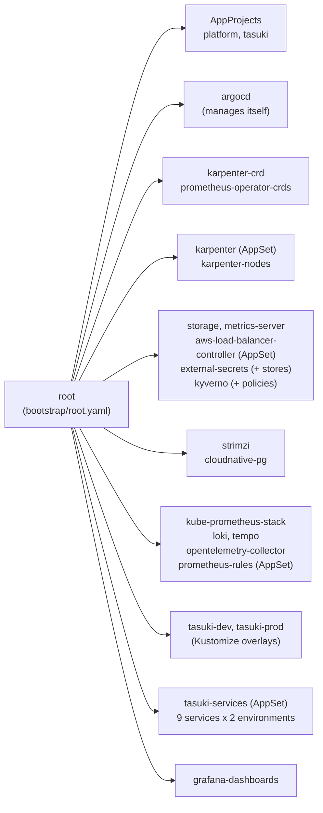

# deploy/: everything that runs inside the cluster

Argo CD installs and keeps in sync everything in this directory. Design background is in
[docs/design.md](../docs/design.md) §6, §10–12. The AWS side is in [infra/platform](../infra/platform).

## The boundary

| Layer | Owned by | Lives in |
|---|---|---|
| AWS: VPC, EKS, the system node group, IAM roles (Pod Identity), SQS, EBS CSI add-on | Terraform | `infra/platform/` |
| Kubernetes: controllers, operators, policies, observability, data stores, services | Argo CD | `deploy/` |

Terraform stops at the cluster API. One script, `deploy/bootstrap/bootstrap.sh`, crosses the line once: it
installs Argo CD and passes it the few values only Terraform knows (the "GitOps bridge", below). After that,
every change to the cluster is a pull request to `deploy/`.

## Layout

```text
deploy/
├── bootstrap/        argocd-values.yaml, root.yaml (the app of apps), bootstrap.sh
├── platform/         one file per platform component: Argo CD Applications and ApplicationSets
│   ├── values/       Helm values for the third-party charts
│   └── manifests/    plain manifests: NodePool + EC2NodeClass, StorageClass, ClusterSecretStores, Grafana admin
├── policies/         Kyverno policies, and tests/ for `kyverno test`
├── charts/
│   ├── service/          the one Helm chart every Tasuki service is deployed with
│   └── prometheus-rules/ wraps a plain Prometheus rule file from observability/ in a PrometheusRule
├── apps/
│   ├── services/     Helm values per service: what the service is
│   ├── base/         Kustomize: what exists once per environment (namespace, quota, network policies,
│   │                 secrets, Kafka, PostgreSQL, Valkey)
│   └── overlays/     dev/ and prod/: Kustomize patches, and values/ (Helm values per environment)
└── scripts/lint.sh   static checks (`make deploy-lint`)
```

## App of apps



The root Application syncs `deploy/platform/kustomization.yaml`, which lists every component file.
ApplicationSets are used only where something is generated: Karpenter and the AWS Load Balancer Controller
(from the cluster Secret's annotations), SLO rules (one per rule file in `observability/`) and services
(one per service and environment).

### Sync waves

Waves order the root app's children. Argo CD waits for each wave to be **Healthy** before the next one,
because `argocd-values.yaml` restores the health check for `Application` objects (removed from the defaults
in Argo CD 1.8). An ApplicationSet is healthy as soon as it has generated its Applications, so anything that
follows one tolerates a short wait through automated-sync retries.

| Wave | What | Why here |
|---:|---|---|
| -10 | AppProjects, `argocd` | Everything else belongs to a project; Argo CD adopts its own Helm install |
| -9 | `karpenter-crd`, `prometheus-operator-crds` | CRDs first, so later charts' NodePools and ServiceMonitors never race them |
| -8 | `karpenter` (AppSet), `storage` | Karpenter runs on the system nodes; gp3 is the default StorageClass |
| -7 | `karpenter-nodes` | NodePool health needs a running controller, so this wave waits for Karpenter |
| -6 | `metrics-server`, `strimzi`, `cloudnative-pg` | First workloads on Karpenter nodes; operators before their clusters |
| -5 | `aws-load-balancer-controller` (AppSet), `external-secrets`, `kyverno` | Webhook-based controllers |
| -4 | `external-secrets-stores`, `monitoring-secrets`, `kyverno-policies`, `kube-prometheus-stack`, `loki`, `tempo` | Need the CRDs and webhooks above |
| -3 | `opentelemetry-collector`, `prometheus-rules` (AppSet) | Need Tempo, Loki and Prometheus |
| 0 | `tasuki-dev`, `tasuki-prod` | Namespace, secrets, Kafka, PostgreSQL, Valkey: Healthy before any service starts |
| 1 | `tasuki-services` (AppSet) | The services |
| 2 | `grafana-dashboards` | Dashboards from `observability/dashboards/`; nothing waits for them |

## Namespaces and data stores

| Namespace | What runs there |
|---|---|
| `argocd` | Argo CD (system nodes) |
| `kube-system` | Karpenter (system nodes), AWS Load Balancer Controller, metrics-server, EKS add-ons |
| `external-secrets`, `kyverno` | External Secrets Operator; Kyverno and its reports |
| `monitoring` | Prometheus, Alertmanager, Grafana, Loki, Tempo, the OpenTelemetry collector (DaemonSet) |
| `strimzi`, `cnpg-system` | The Kafka and PostgreSQL operators (they watch every namespace) |
| `tasuki-dev`, `tasuki-prod` | One environment each: the services and their own Kafka, PostgreSQL and Valkey |

Each environment namespace has its own data stores (`apps/base/`, sized by the overlays). Names are the same
in both namespaces:

| Store | Objects | Dev | Prod |
|---|---|---|---|
| Kafka 4.3 (Strimzi, KRaft) | Kafka `tasuki`, node pool `dual-role` (controller + broker), pods `tasuki-dual-role-<n>`, bootstrap `tasuki-kafka-bootstrap:9092`, topics `courier.locations` (24 h), `orders.events` and `dispatch.events` (7 days), 12 partitions each; Kafka Exporter for consumer lag | 1 node, replication factor 1 | 3 nodes, one per AZ, replication factor 3, `min.insync.replicas` 2 |
| PostgreSQL 18 (CloudNativePG) | Cluster `orders-db`, database and owner `orders`; Services `orders-db-rw` (primary), `orders-db-ro`, `orders-db-r`; Secret `orders-db-app` (key `uri` = `DATABASE_URL`) | 1 instance | 2 instances (primary + asynchronous standby in another AZ) |
| Valkey 9 (Redis protocol) | StatefulSet `redis` (pod `redis-0`), Service `redis:6379`; no persistence, rebuilt from `courier.locations` by fleet-state | 1 | 1 |

**Backups: none yet.** CloudNativePG has no backup or WAL archive configured (that needs the Barman Cloud
plugin, an S3 bucket and a Pod Identity role from Terraform). Losing a PostgreSQL volume loses its data; in
prod the standby has a copy, minus the last asynchronously replicated transactions. Kafka keeps data on its
volumes only (`deleteClaim: false` in prod). Valkey has nothing to back up by design.

Useful handles for drills: `kubectl -n tasuki-prod get cluster orders-db` (and the `cnpg` kubectl plugin for
`promote`/`status`), `kubectl -n tasuki-prod get kafka,kafkanodepool,kafkatopic`, deleting
`tasuki-dual-role-<n>` or `redis-0` to kill a broker or the cache.

## Bootstrap

Prerequisites: `make aws-up` and `make kubeconfig` (infra/), then the application secrets in Secrets Manager
(next section).

```bash
make gitops-bootstrap      # = deploy/bootstrap/bootstrap.sh
```

It reads `terraform -chdir=infra/platform output -json`, checks that the current kube context really is that
cluster, installs Argo CD with Helm (same chart version and values as `platform/argocd.yaml`), registers the
cluster with Argo CD, and applies `bootstrap/root.yaml`. It is safe to re-run.

**The GitOps bridge.** The registration is Argo CD's cluster Secret for `in-cluster`, labelled
`tasuki.io/platform=true` and annotated with Terraform's values:

| Annotation | Terraform output | Used by |
|---|---|---|
| `cluster_name` | `cluster_name` | Karpenter `settings.clusterName`, LB controller `clusterName` |
| `karpenter_queue_name` | `karpenter_queue_name` | Karpenter `settings.interruptionQueue` |
| `vpc_id` | `vpc_id` | LB controller `vpcId` (pods cannot read it from IMDS: hop limit 1) |
| `region` | `region` | LB controller `region` |
| `aws_account_id` | `account_id` | Nothing yet (S3 bucket names for backups will need it) |

ApplicationSets with a cluster generator select that label and template the annotations into Helm
`valuesObject`. Everything else in git uses names Terraform fixes on purpose: role `tasuki-karpenter-node`,
discovery tag `karpenter.sh/discovery=tasuki`, Pod Identity service accounts `kube-system/karpenter`,
`kube-system/aws-load-balancer-controller` and `external-secrets/external-secrets`.

After bootstrap, Argo CD owns its own install: an upgrade is a PR that bumps `targetRevision` in
`platform/argocd.yaml` and `ARGOCD_CHART_VERSION` in `bootstrap.sh` (the lint fails if they differ).
UI: `kubectl -n argocd port-forward svc/argocd-server 8080:443`. There is no Ingress for Argo CD.

## Secrets

Nothing secret is in git. External Secrets copies one JSON secret per environment from AWS Secrets Manager
into the Kubernetes Secret `tasuki-app`. Each environment has its own ClusterSecretStore, locked to its
namespace and its prefix, so `tasuki-dev` cannot read `tasuki/prod/*`. PostgreSQL credentials never leave
the cluster: CloudNativePG creates `orders-db-app` itself.

| Key in `tasuki/<env>/app` | Used by |
|---|---|
| `DJANGO_SECRET_KEY` | orders (all three processes) |
| `ORDERS_FIELD_KEY` | orders: Fernet key for PII fields |
| `COURIER_TOKEN_SECRET` | orders (issues), fleet-ingest and dispatch (verify); at least 32 bytes |
| `TRACKING_TOKEN_SECRET` | orders (issues), tracking (verifies); at least 32 bytes |
| `ADMIN_TOKEN` | orders seeding API, simulator |
| `FLEET_STREAM_TOKEN` | tracking: the ops console's fleet stream |

```bash
for env in dev prod; do
  aws secretsmanager create-secret --region ap-northeast-1 --name "tasuki/${env}/app" \
    --secret-string "$(jq -n \
      --arg django "$(openssl rand -base64 48)" \
      --arg field "$(openssl rand 32 | basenc --base64url)" \
      --arg courier "$(openssl rand -hex 32)" --arg tracking "$(openssl rand -hex 32)" \
      --arg admin "$(openssl rand -hex 24)" --arg fleet "$(openssl rand -hex 24)" \
      '{DJANGO_SECRET_KEY: $django, ORDERS_FIELD_KEY: $field, COURIER_TOKEN_SECRET: $courier,
        TRACKING_TOKEN_SECRET: $tracking, ADMIN_TOKEN: $admin, FLEET_STREAM_TOKEN: $fleet}')"
done
```

Until these exist the `tasuki-<env>` Applications stay Degraded (ExternalSecret not synced) and the services
are not created, which is intended: they cannot start without them.

## Services: Helm for what repeats, Kustomize for what exists once

- **Helm** (`charts/service`) renders what every service has: Deployment, Service, ServiceAccount, PDB,
  NetworkPolicy, ServiceMonitor, and optionally HPA, Ingress, a PreSync migration Job and CronJobs. The chart
  implements the runtime contract in [docs/architecture.md](../docs/architecture.md): `/healthz` liveness,
  `/readyz` readiness, `/metrics`, non-root, read-only root filesystem with an emptyDir `/tmp`, all
  capabilities dropped, spread across zones, and graceful shutdown (a built-in `preStop` sleep of 5 s, then the
  app's own 20 s drain, inside `terminationGracePeriodSeconds: 30`; the chart refuses to render if the sum
  does not fit).
- **Kustomize** (`apps/base` + `apps/overlays/<env>`) renders what exists once per namespace and differs by
  environment: the Namespace (Pod Security `restricted`), ResourceQuota, default-deny ingress, the data stores
  and their sizes (dev: 1 Kafka node, 1 PostgreSQL instance; prod: 3 and 2).

The `tasuki-services` ApplicationSet creates one Application per service and environment, rendering the
chart with these values files, lowest precedence first:

1. `charts/service/values.yaml`: the defaults (the runtime contract)
2. `apps/overlays/<env>/values/common.yaml`: the environment (image tag, replica count)
3. `apps/services/<service>.yaml`: the service (image, port, command, env, secrets, network)
4. `apps/overlays/<env>/values/<service>.yaml`: the service in that environment (optional)

**Add a service:** write `apps/services/<name>.yaml` (copy the closest one), add `- service: <name>` to the
list in `platform/tasuki.yaml`, and allow its traffic: `networkPolicy.allowFrom` for callers,
`networkPolicy.egress` for what it calls, and its name in the data store policy if it needs one
(`apps/base/network-policies.yaml`, the Kafka listener's `networkPolicyPeers`). `make deploy-lint` renders it
and checks it against the policies.

**CPU architecture:** the chart pins pods to `kubernetes.io/arch: amd64` because `release.yml` builds
single-architecture images, while Karpenter may launch Graviton (arm64) nodes. Once images are multi-arch,
remove the default in `charts/service/values.yaml` and Karpenter can pick the cheaper arm64 nodes.

**Promote a release:** images are `ghcr.io/codewithmuh/tasuki-delivery-platform/<service>:<version>`, one
version for the whole repository (release-please). Change `image.tag` in `overlays/dev/values/common.yaml`,
then the same in `overlays/prod/values/common.yaml`. Never `latest`: the chart and Kyverno both refuse it.

**Run the simulator:** set `replicas: 1` (and `args` for another scenario) in
`overlays/<env>/values/simulator.yaml`. It is at 0 by default.

**Dashboards:** `observability/dashboards/kustomization.yaml` turns the JSON files next to it into ConfigMaps
labelled `grafana_dashboard: "1"` in `monitoring` (configMapGenerator, `disableNameSuffixHash: true`); the
`grafana-dashboards` Application syncs that directory.

## Policies

Kyverno 1.19 deprecates `ClusterPolicy`, so the policies use the CEL-based `policies.kyverno.io/v1` types,
the same expression language as Kubernetes' ValidatingAdmissionPolicy.

| Policy | Scope | Mode |
|---|---|---|
| `disallow-latest-tag`: a fixed tag or a digest, never `:latest` or untagged | all namespaces except kube-system, kube-public, kube-node-lease, kyverno | Deny |
| `require-requests-limits`: CPU and memory requests, memory limit (no CPU limit required: it only throttles) | Tasuki namespaces | Deny |
| `require-probes`: readiness and liveness on every Deployment container | Tasuki namespaces | Deny |
| `restrict-pod-security`: runAsNonRoot, no privilege escalation, drop ALL, read-only root filesystem | Tasuki namespaces | Deny |
| `verify-image-signatures`: our images are cosign keyless-signed by `release.yml` | all except system namespaces | **Audit** |

Pod Security Admission (`restricted`, a namespace label) already blocks most of what `restrict-pod-security`
checks, but only at Pod creation, where a Deployment just stops progressing. The Kyverno policies also match
Deployments, StatefulSets, Jobs and CronJobs, so Argo CD's sync fails with the reason.

The signature policy stays in Audit until (1) `release.yml` publishes and signs every service image,
(2) the PolicyReports in both namespaces show no failures for a full release cycle
(`kubectl get policyreports -A`), and (3) the Kyverno admission controller is HA. Enforce makes Kyverno a
hard dependency of every pod start. It accepts certificates for `release.yml` on `refs/heads/main`, because
that workflow runs on pushes to main and release-please creates the tag in the same run, and on
`refs/tags/vX.Y.Z`, in case releases move to a tag-triggered workflow.

Tests: `kyverno test deploy/policies/tests`. Each bad fixture differs from the good one in one field.

## Observability

- **Metrics:** one Prometheus (kube-prometheus-stack) that selects every ServiceMonitor, PodMonitor and
  PrometheusRule in the cluster. The chart gives every service a ServiceMonitor; Prometheus adds `namespace`
  and `service` labels, which the SLO rules filter on (`namespace="tasuki-prod"`, `service="orders"`).
- **SLOs and alerts:** `observability/` keeps plain Prometheus rule files, so promtool can test them
  (`make slo-check`). The `prometheus-rules` ApplicationSet wraps each file in a PrometheusRule; a new file
  needs no change here.
- **Traces, logs, OTLP metrics:** an OpenTelemetry collector on every node. Services get the standard
  `OTEL_EXPORTER_OTLP_ENDPOINT`, `OTEL_SERVICE_NAME` and `OTEL_RESOURCE_ATTRIBUTES` from the chart and send to
  the collector on their own node. Traces go to Tempo, metrics to Prometheus' OTLP receiver, and container
  logs (read from the node) plus OTLP logs go to Loki's OTLP endpoint.
- **Grafana:** Prometheus, Loki and Tempo data sources, with trace-to-logs. Dashboards are loaded from any
  ConfigMap labelled `grafana_dashboard=1` (Strimzi's and CloudNativePG's are installed). Admin password:
  `kubectl -n monitoring get secret grafana-admin -o jsonpath='{.data.admin-password}' | base64 -d`.

## Static checks

`make deploy-lint` (and the CI job "GitOps manifests (helm, kustomize, kubeconform, kyverno)") renders what
Argo CD would render, from the same files, and checks it:

1. Argo CD's chart version is the same in `bootstrap.sh` and `platform/argocd.yaml`; every cluster annotation
   an ApplicationSet reads is one that `bootstrap.sh` writes.
2. `helm lint --strict` on both local charts.
3. Every pinned third-party chart rendered with its values files and `valuesObject` (cluster annotations
   replaced by sample values), every Kustomize directory, the service chart for each service and environment,
   and the rules chart for each rule file.
4. `kubeconform -strict` against Kubernetes 1.35, with JSON schemas generated from the CRDs of the exact
   chart versions pinned here (the datreeio CRDs-catalog, pinned to a commit, as a fallback).
   CustomResourceDefinitions themselves are skipped: no schema exists for that kind.
5. `kyverno test` on the policies, then the rendered Tasuki workloads against the policies.
6. Trivy on the rendered Tasuki workloads (the repository-wide scan cannot render the service chart, whose
   image is required).
7. `shellcheck` on the scripts.

Nothing needs a cluster or cloud credentials. Charts and schemas are cached in `~/.cache/tasuki-deploy-lint`.

## Versions

| Component | Chart | Chart version | App version | Source |
|---|---|---|---|---|
| Argo CD | argo-cd | 10.10.3 | v3.5.5 | argoproj.github.io/argo-helm |
| Karpenter | karpenter, karpenter-crd | 1.15.0 | 1.15.0 | oci://public.ecr.aws/karpenter |
| AWS Load Balancer Controller | aws-load-balancer-controller | 3.6.0 | v3.6.0 | aws.github.io/eks-charts |
| metrics-server | metrics-server | 3.14.0 | 0.9.0 | kubernetes-sigs.github.io/metrics-server |
| External Secrets | external-secrets | 2.12.0 | v2.12.0 | charts.external-secrets.io |
| Kyverno | kyverno | 3.9.1 | v1.19.1 | kyverno.github.io/kyverno |
| Prometheus Operator CRDs | prometheus-operator-crds | 32.0.1 | v0.94.1 | prometheus-community.github.io/helm-charts |
| kube-prometheus-stack | kube-prometheus-stack | 92.4.0 | v0.94.1 | prometheus-community.github.io/helm-charts |
| Loki | loki | 18.15.1 | 3.7.8 | grafana-community.github.io/helm-charts |
| Tempo | tempo | 3.1.0 | 3.1.0 | grafana-community.github.io/helm-charts |
| OpenTelemetry Collector | opentelemetry-collector | 0.176.0 | 0.162.0 (k8s distribution) | open-telemetry.github.io/opentelemetry-helm-charts |
| Strimzi | strimzi-kafka-operator | 1.3.0 | 1.3.0, Kafka 4.3.1 | strimzi.io/charts |
| CloudNativePG | cloudnative-pg | 0.29.1 | 1.30.1, PostgreSQL 18.6 | cloudnative-pg.github.io/charts |
| Valkey | (manifest) | | 9.0.6-alpine | docker.io/valkey/valkey |

Grafana moved the OSS Loki and Tempo charts to `grafana-community` in 2026; the `grafana/tempo` chart is
deprecated. Bitnami charts and images are not used.

Lint tooling (pinned with checksums in `.github/workflows/deploy.yml`): helm v4.2.4, kustomize v5.8.3,
yq v4.54.1, kubeconform v0.8.0, Kyverno CLI v1.19.1, Trivy 0.75.0, ShellCheck v0.11.0.

**Updating chart versions:** Dependabot cannot see a chart version inside an Argo CD Application. Renovate's
`argocd` manager can: it reads `repoURL`, `chart` and `targetRevision`, OCI included. A root `renovate.json`
limited to that manager (plus a regex manager for `ARGOCD_CHART_VERSION` in `bootstrap.sh`) is the proposed
fix. Until then, bump `targetRevision` by hand and run `make deploy-lint`.

## Decisions

Proposed here, following the design's leanings; each needs its ADR (docs/design.md §14):

| Decision | Choice | ADR |
|---|---|---|
| GitOps tool | Argo CD, app of apps, self-managed | 0011, proposed, pending |
| Policy engine | Kyverno, CEL policy types | 0013, proposed, pending |
| Secrets | External Secrets + Secrets Manager, one store per environment | 0014, proposed, pending |
| Kafka | Strimzi, KRaft, per-environment cluster | 0004, proposed, pending |
| PostgreSQL | CloudNativePG, per-environment cluster | 0005, proposed, pending |
| SLO tooling | Sloth, rule files wrapped by a chart | 0015, proposed, pending |
| Terraform/GitOps boundary | Terraform stops at the cluster API; values cross through cluster-Secret annotations | 0018, pending |

Not yet in the ADR list, worth recording: the Helm/Kustomize split; data stores per environment namespace
with cluster-wide operators; Valkey instead of Redis; NetworkPolicy model (namespace default-deny ingress,
per-service egress allow-lists); image-signature Audit-to-Enforce criteria; OpenTelemetry collector as a
DaemonSet for logs, traces and metrics; Loki/Tempo monolithic on EBS (not S3) for dev.

## Not verified yet (no cluster)

Everything above is checked statically. These need the first cluster run:

- Pods of operator-managed workloads (Kafka, the topic operator, Kafka Exporter, PostgreSQL and its initdb
  Job) passing the `restricted` profile and the Deny policies with the security contexts set here.
- NetworkPolicies as enforced by the VPC CNI (`enableNetworkPolicy` is on in `infra/platform/eks.tf`).
- The `argocd` Application adopting the Helm install without churn, and the sync waves end to end.
- ALB Ingress (no domain or ACM certificate yet, so every service has `ingress.enabled: false`).
- Image signature verification against a real Tasuki release. The attestor configuration was checked once,
  online, against Argo CD's own keyless-signed image: it verifies with the right identity and fails with a
  wrong one.
- PostgreSQL backups to S3 are not set up: losing the volume loses the data (synthetic, re-seeded by the
  simulator).
