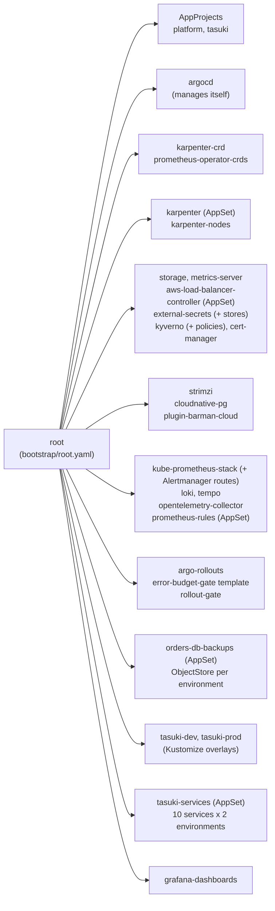

# deploy/: everything that runs inside the cluster

Argo CD installs and keeps in sync everything in this directory. Design background is in
[docs/design.md](../docs/design.md) §6, §10–12. The AWS side is in [infra/platform](../infra/platform).

## The boundary

| Layer | Owned by | Lives in |
|---|---|---|
| AWS: VPC, EKS, the system node group, IAM roles (Pod Identity), SQS, EBS CSI add-on | Terraform | `infra/platform/` |
| Kubernetes: controllers, operators, policies, observability, data stores, services | Argo CD | `deploy/` |

Terraform stops at the cluster API. One script, `deploy/bootstrap/bootstrap.sh`, crosses the line once: it
installs Argo CD and passes it the few values only Terraform knows (the "GitOps bridge", below). After that,
every change to the cluster is a pull request to `deploy/`.

## Layout

```text
deploy/
├── bootstrap/        argocd-values.yaml, root.yaml (the app of apps), bootstrap.sh
├── platform/         one file per platform component: Argo CD Applications and ApplicationSets
│   ├── values/       Helm values for the third-party charts
│   └── manifests/    plain manifests: NodePool + EC2NodeClass, StorageClass, ClusterSecretStores, Grafana admin,
│                     Alertmanager routes, the error-budget ClusterAnalysisTemplate
├── policies/         Kyverno policies, and tests/ for `kyverno test`
├── charts/
│   ├── service/          the one Helm chart every Tasuki service (and the rollout gate) is deployed with
│   ├── postgres-backup/  the ObjectStore a CloudNativePG cluster archives to (bucket and path from Terraform)
│   └── prometheus-rules/ wraps a plain Prometheus rule file from observability/ in a PrometheusRule
├── apps/
│   ├── services/     Helm values per service: what the service is
│   ├── base/         Kustomize: what exists once per environment (namespace, quota, network policies,
│   │                 secrets, Kafka, PostgreSQL, Valkey)
│   └── overlays/     dev/ and prod/: Kustomize patches, and values/ (Helm values per environment)
└── scripts/lint.sh   static checks (`make deploy-lint`)
```

## App of apps



The root Application syncs `deploy/platform/kustomization.yaml`, which lists every component file.
ApplicationSets are used only where something is generated: Karpenter, the AWS Load Balancer Controller and
the orders-db backup stores (from the cluster Secret's annotations), SLO rules (one per rule file in
`observability/`) and services (one per service and environment).

### Sync waves

Waves order the root app's children. Argo CD waits for each wave to be **Healthy** before the next one,
because `argocd-values.yaml` restores the health check for `Application` objects (removed from the defaults
in Argo CD 1.8). An ApplicationSet is healthy as soon as it has generated its Applications, so anything that
follows one tolerates a short wait through automated-sync retries.

| Wave | What | Why here |
|---:|---|---|
| -10 | AppProjects, `argocd` | Everything else belongs to a project; Argo CD adopts its own Helm install |
| -9 | `karpenter-crd`, `prometheus-operator-crds` | CRDs first, so later charts' NodePools and ServiceMonitors never race them |
| -8 | `karpenter` (AppSet), `storage` | Karpenter runs on the system nodes; gp3 is the default StorageClass |
| -7 | `karpenter-nodes` | NodePool health needs a running controller, so this wave waits for Karpenter |
| -6 | `metrics-server`, `strimzi`, `cloudnative-pg`, `cert-manager` | First workloads on Karpenter nodes; operators before their clusters |
| -5 | `aws-load-balancer-controller` (AppSet), `external-secrets`, `kyverno`, `plugin-barman-cloud`, `argo-rollouts` | Webhook-based controllers; the backup plugin needs cert-manager's certificates; Rollout CRDs before any service renders a Rollout |
| -4 | `external-secrets-stores`, `monitoring-secrets`, `kyverno-policies`, `kube-prometheus-stack`, `loki`, `tempo`, `argo-rollouts-analysis` | Need the CRDs and webhooks above |
| -3 | `opentelemetry-collector`, `prometheus-rules` (AppSet), `rollout-gate` | Need Tempo, Loki and Prometheus |
| -1 | `orders-db-backups` (AppSet) | The ObjectStore exists before `orders-db` archives its first WAL segment; creates the namespace if needed |
| 0 | `tasuki-dev`, `tasuki-prod` | Namespace, secrets, Kafka, PostgreSQL, Valkey: Healthy before any service starts (the ScheduledBackup is wave 1 inside, after the Cluster) |
| 1 | `tasuki-services` (AppSet) | The services |
| 2 | `grafana-dashboards` | Dashboards from `observability/dashboards/`; nothing waits for them |

## Namespaces and data stores

| Namespace | What runs there |
|---|---|
| `argocd` | Argo CD (system nodes) |
| `kube-system` | Karpenter (system nodes), AWS Load Balancer Controller, metrics-server, EKS add-ons |
| `external-secrets`, `kyverno`, `cert-manager` | External Secrets Operator; Kyverno and its reports; cert-manager |
| `monitoring` | Prometheus, Alertmanager, Grafana, Loki, Tempo, the OpenTelemetry collector (DaemonSet), the rollout gate |
| `strimzi`, `cnpg-system` | The Kafka and PostgreSQL operators (they watch every namespace); the Barman Cloud plugin next to CloudNativePG |
| `argo-rollouts` | The Argo Rollouts controller (2 replicas) |
| `tasuki-dev`, `tasuki-prod` | One environment each: the services and their own Kafka, PostgreSQL and Valkey |

Each environment namespace has its own data stores (`apps/base/`, sized by the overlays). Names are the same
in both namespaces:

| Store | Objects | Dev | Prod |
|---|---|---|---|
| Kafka 4.3 (Strimzi, KRaft) | Kafka `tasuki`, node pool `dual-role` (controller + broker), pods `tasuki-dual-role-<n>`, bootstrap `tasuki-kafka-bootstrap:9092`, topics `courier.locations` (24 h), `orders.events` and `dispatch.events` (7 days), 12 partitions each; Kafka Exporter for consumer lag | 1 node, replication factor 1 | 3 nodes, one per AZ, replication factor 3, `min.insync.replicas` 2 |
| PostgreSQL 18 (CloudNativePG) | Cluster `orders-db`, database and owner `orders`; Services `orders-db-rw` (primary), `orders-db-ro`, `orders-db-r`; Secret `orders-db-app` (key `uri` = `DATABASE_URL`) | 1 instance | 2 instances (primary + asynchronous standby in another AZ) |
| Valkey 9 (Redis protocol) | StatefulSet `redis` (pod `redis-0`), Service `redis:6379`; no persistence, rebuilt from `courier.locations` by fleet-state | 1 | 1 |

**Backups:** `orders-db` archives its WAL continuously and takes base backups (dev daily, prod hourly, plus one
as soon as the cluster is up) to an S3 bucket that outlives the platform; a restore goes into a new cluster.
See [Backups and restore](#backups-and-restore). Kafka keeps data on its volumes only (`deleteClaim: false` in
prod). Valkey has nothing to back up by design.

Useful handles for drills: `kubectl -n tasuki-prod get cluster orders-db` (and the `cnpg` kubectl plugin for
`promote`/`status`), `kubectl -n tasuki-prod get kafka,kafkanodepool,kafkatopic`, deleting
`tasuki-dual-role-<n>` or `redis-0` to kill a broker or the cache.

## Bootstrap

Prerequisites: `make aws-up` and `make kubeconfig` (infra/), then the application secrets in Secrets Manager
(next section).

```bash
make gitops-bootstrap      # = deploy/bootstrap/bootstrap.sh
```

It reads `terraform -chdir=infra/platform output -json`, checks that the current kube context really is that
cluster, installs Argo CD with Helm (same chart version and values as `platform/argocd.yaml`), registers the
cluster with Argo CD, and applies `bootstrap/root.yaml`. It is safe to re-run.

**The GitOps bridge.** The registration is Argo CD's cluster Secret for `in-cluster`, labelled
`tasuki.io/platform=true` and annotated with Terraform's values:

| Annotation | Terraform output | Used by |
|---|---|---|
| `cluster_name` | `cluster_name` | Karpenter `settings.clusterName`, LB controller `clusterName` |
| `karpenter_queue_name` | `karpenter_queue_name` | Karpenter `settings.interruptionQueue` |
| `vpc_id` | `vpc_id` | LB controller `vpcId` (pods cannot read it from IMDS: hop limit 1) |
| `region` | `region` | LB controller `region` |
| `aws_account_id` | `account_id` | Nothing yet |
| `backup_bucket` | `backup_bucket` | `orders-db-backups` ObjectStores: the bucket (from `infra/bootstrap`) |
| `backup_session` | `backup_session` | `orders-db-backups` ObjectStores: this platform's path in the bucket |

ApplicationSets with a cluster generator select that label and template the annotations into Helm
`valuesObject`. Everything else in git uses names Terraform fixes on purpose: role `tasuki-karpenter-node`,
discovery tag `karpenter.sh/discovery=tasuki`, Pod Identity service accounts `kube-system/karpenter`,
`kube-system/aws-load-balancer-controller`, `external-secrets/external-secrets`, and `tasuki-<env>/orders-db` and
`tasuki-<env>/orders-db-restore` (the CloudNativePG clusters' ServiceAccounts, for backups).

After bootstrap, Argo CD owns its own install: an upgrade is a PR that bumps `targetRevision` in
`platform/argocd.yaml` and `ARGOCD_CHART_VERSION` in `bootstrap.sh` (the lint fails if they differ).
UI: `kubectl -n argocd port-forward svc/argocd-server 8080:443`. There is no Ingress for Argo CD.

## Secrets

Nothing secret is in git. External Secrets copies one JSON secret per environment from AWS Secrets Manager
into the Kubernetes Secret `tasuki-app`. Each environment has its own ClusterSecretStore, locked to its
namespace and its prefix, so `tasuki-dev` cannot read `tasuki/prod/*`. PostgreSQL credentials never leave
the cluster: CloudNativePG creates `orders-db-app` itself.

The ExternalSecret ([apps/base/external-secret.yaml](apps/base/external-secret.yaml)) lists every key below
explicitly (`data[].remoteRef.property`), rather than copying whatever the JSON holds (`dataFrom.extract`).
A key missing from Secrets Manager therefore fails the sync loudly: the ExternalSecret goes `Ready=False`
(`SecretSyncedError`), `tasuki-<env>` turns Degraded, and the last good Kubernetes Secret stays in place,
so no pod ever starts without the key. That file is the one list; `make deploy-lint` fails if a service's
`secretEnv` uses a `tasuki-app` key it does not contain. A new key: add it there, to this table, and to the
secret in Secrets Manager **before** merging.

| Key in `tasuki/<env>/app` | Used by |
|---|---|
| `DJANGO_SECRET_KEY` | orders (all three processes) |
| `ORDERS_FIELD_KEY` | orders: Fernet key for PII fields |
| `COURIER_TOKEN_SECRET` | orders (issues), fleet-ingest and dispatch (verify); at least 32 bytes |
| `TRACKING_TOKEN_SECRET` | orders (issues), tracking (verifies); at least 32 bytes |
| `ADMIN_TOKEN` | orders seeding API, simulator |
| `FLEET_STREAM_TOKEN` | tracking: the ops console's fleet stream |

```bash
for env in dev prod; do
  aws secretsmanager create-secret --region ap-northeast-1 --name "tasuki/${env}/app" \
    --secret-string "$(jq -n \
      --arg django "$(openssl rand -base64 48)" \
      --arg field "$(openssl rand 32 | basenc --base64url)" \
      --arg courier "$(openssl rand -hex 32)" --arg tracking "$(openssl rand -hex 32)" \
      --arg admin "$(openssl rand -hex 24)" --arg fleet "$(openssl rand -hex 24)" \
      '{DJANGO_SECRET_KEY: $django, ORDERS_FIELD_KEY: $field, COURIER_TOKEN_SECRET: $courier,
        TRACKING_TOKEN_SECRET: $tracking, ADMIN_TOKEN: $admin, FLEET_STREAM_TOKEN: $fleet}')"
done
```

Until these exist the `tasuki-<env>` Applications stay Degraded (ExternalSecret not synced) and the services
are not created, which is intended: they cannot start without them.

The third store, `tasuki-monitoring` (namespace `monitoring`, prefix `tasuki/monitoring/`), holds the Slack
webhook for Alertmanager; see [Alerting](#alerting).

## Services: Helm for what repeats, Kustomize for what exists once

- **Helm** (`charts/service`) renders what every service has: Deployment (or, with `rollout.enabled`, an Argo
  Rollouts Rollout), Service, ServiceAccount, PDB, NetworkPolicy, ServiceMonitor, and optionally HPA, Ingress, a
  PreSync migration Job, CronJobs and a ConfigMap of read-only files (`files`). The chart
  implements the runtime contract in [docs/architecture.md](../docs/architecture.md): `/healthz` liveness,
  `/readyz` readiness, `/metrics`, non-root, read-only root filesystem with an emptyDir `/tmp`, all
  capabilities dropped, spread across zones, and graceful shutdown (a built-in `preStop` sleep of 5 s, then the
  app's own 20 s drain, inside `terminationGracePeriodSeconds: 30`; the chart refuses to render if the sum
  does not fit).
- **Kustomize** (`apps/base` + `apps/overlays/<env>`) renders what exists once per namespace and differs by
  environment: the Namespace (Pod Security `restricted`), ResourceQuota, default-deny ingress, the data stores
  and their sizes (dev: 1 Kafka node, 1 PostgreSQL instance; prod: 3 and 2).

The `tasuki-services` ApplicationSet creates one Application per service and environment, rendering the
chart with these values files, lowest precedence first:

1. `charts/service/values.yaml`: the defaults (the runtime contract)
2. `apps/overlays/<env>/values/common.yaml`: the environment (image tag, replica count)
3. `apps/services/<service>.yaml`: the service (image, port, command, env, secrets, network)
4. `apps/overlays/<env>/values/<service>.yaml`: the service in that environment (optional)

**Add a service:** write `apps/services/<name>.yaml` (copy the closest one), add `- service: <name>` to the
list in `platform/tasuki.yaml`, and allow its traffic: `networkPolicy.allowFrom` for callers,
`networkPolicy.egress` for what it calls, and its name in the data store policy if it needs one
(`apps/base/network-policies.yaml`, the Kafka listener's `networkPolicyPeers`). `make deploy-lint` renders it
and checks it against the policies.

**CPU architecture:** `release.yml` publishes every image for amd64 and arm64, so the chart sets no
`nodeSelector` and Karpenter may place pods on the cheaper Graviton nodes. Set one per service only if it truly
needs it.

**Autoscaling:** HPAs on CPU for the two services that take the location load. Targets and limits, with the
reasons in the values files:

| Service | dev | prod | CPU target | Why |
|---|---|---|---|---|
| fleet-ingest | 1–3 | 2–6 | 70 % | Stateless and ready at once; the hot path at peak (~750 GPS points/s) |
| tracking | 1–3 | 2–6 | 60 %, scale-down after 10 min | New replicas replay two topics before they are ready, so they start earlier; a scale-down drops SSE connections, so it waits |

The prod ResourceQuota (8 CPU, 16 GiB requested) covers every service at its maximum plus one canary pod each,
the data stores and the backup sidecars (about 4.3 CPU and 10 GiB).

**Console:** static files from nginx-unprivileged (uid 101, `/tmp` emptyDir, `/healthz` and `/readyz`). The
browser opens the SSE streams on tracking itself; nginx proxies nothing, so the console's NetworkPolicy allows
only DNS out, and nothing in the cluster calls it. Until there is an ingress and a domain, open it in dev with
two port-forwards (`CONSOLE_TRACKING_BASE_URL` and tracking's `TRACKING_CORS_ORIGINS` are set for this in
`overlays/dev/values/`):

```bash
kubectl -n tasuki-dev port-forward svc/console 8088:80 &
kubectl -n tasuki-dev port-forward svc/tracking 8081:80 &
open http://localhost:8088
```

**Promote a release:** images are `ghcr.io/codewithmuh/tasuki-delivery-platform/<service>:<version>`, one
version for the whole repository (release-please). Change `image.tag` in `overlays/dev/values/common.yaml`,
then the same in `overlays/prod/values/common.yaml`. Never `latest`: the chart and Kyverno both refuse it.

**Run the simulator:** set `replicas: 1` in `overlays/<env>/values/simulator.yaml`. It is at 0 by default.
The scenario is `env.SCENARIO`: a built-in name (`small`, `normal-weekday`, `rainy-friday`), or a file of your
own mounted from the chart's `files`:

```yaml
# overlays/prod/values/simulator.yaml
replicas: 1
env:
  SCENARIO: /etc/tasuki/rainy-friday-x10.yaml   # or: rainy-friday
files:
  rainy-friday-x10.yaml: |
    name: rainy-friday-x10
    # ... the scenario format in services/simulator/README.md
```

A changed file rolls the pod (the chart adds a checksum of `files` to the pod template). `args` still works for
flags such as `-duration 2h`: `args: [run, -duration, 2h]`. A scenario used for a game day is better added as a
built-in in `services/simulator/scenarios/`, where the simulator's tests validate it; `files` is for one-offs.

**Dashboards:** `observability/dashboards/kustomization.yaml` turns the JSON files next to it into ConfigMaps
labelled `grafana_dashboard: "1"` in `monitoring` (configMapGenerator, `disableNameSuffixHash: true`); the
`grafana-dashboards` Application syncs that directory.

## Policies

Kyverno 1.19 deprecates `ClusterPolicy`, so the policies use the CEL-based `policies.kyverno.io/v1` types,
the same expression language as Kubernetes' ValidatingAdmissionPolicy.

| Policy | Scope | Mode |
|---|---|---|
| `disallow-latest-tag`: a fixed tag or a digest, never `:latest` or untagged | all namespaces except kube-system, kube-public, kube-node-lease, kyverno | Deny |
| `require-requests-limits`: CPU and memory requests, memory limit (no CPU limit required: it only throttles) | Tasuki namespaces | Deny |
| `require-probes`: readiness and liveness on every Deployment and Rollout container | Tasuki namespaces | Deny |
| `restrict-pod-security`: runAsNonRoot, no privilege escalation, drop ALL, read-only root filesystem | Tasuki namespaces | Deny |
| `verify-image-signatures`: our images are cosign keyless-signed by `release.yml` | all except system namespaces | **Audit** |

Pod Security Admission (`restricted`, a namespace label) already blocks most of what `restrict-pod-security`
checks, but only at Pod creation, where a Deployment just stops progressing. The Kyverno policies also match
Deployments, StatefulSets, Jobs and CronJobs, so Argo CD's sync fails with the reason.

**Rollouts:** Kyverno's autogen does not know Argo Rollouts, so for a Rollout (prod canaries) only
`require-probes` fails the sync; the other policies, and Pod Security Admission, reject its pods at creation,
where the Rollout stops progressing and goes Degraded. `make deploy-lint` closes the gap before merge: it checks
each rendered Rollout's pod template as the Deployment it would otherwise be. The reports controller can read
Rollouts (`values/kyverno.yaml`), so they appear in PolicyReports.

The signature policy stays in Audit until (1) `release.yml` publishes and signs every service image,
(2) the PolicyReports in both namespaces show no failures for a full release cycle
(`kubectl get policyreports -A`), and (3) the Kyverno admission controller is HA. Enforce makes Kyverno a
hard dependency of every pod start. It accepts certificates for `release.yml` on `refs/heads/main`, because
that workflow runs on pushes to main and release-please creates the tag in the same run, and on
`refs/tags/vX.Y.Z`, in case releases move to a tag-triggered workflow.

Tests: `kyverno test deploy/policies/tests`. Each bad fixture differs from the good one in one field.

## Observability

- **Metrics:** one Prometheus (kube-prometheus-stack) that selects every ServiceMonitor, PodMonitor and
  PrometheusRule in the cluster. The chart gives every service a ServiceMonitor; Prometheus adds `namespace`
  and `service` labels, which the SLO rules filter on (`namespace="tasuki-prod"`, `service="orders"`).
- **SLOs and alerts:** `observability/` keeps plain Prometheus rule files, so promtool can test them
  (`make slo-check`). The `prometheus-rules` ApplicationSet wraps each file in a PrometheusRule; a new file
  needs no change here. Notifications: [Alerting](#alerting).
- **Traces, logs, OTLP metrics:** an OpenTelemetry collector on every node. Services get the standard
  `OTEL_EXPORTER_OTLP_ENDPOINT`, `OTEL_SERVICE_NAME` and `OTEL_RESOURCE_ATTRIBUTES` from the chart and send to
  the collector on their own node. Traces go to Tempo, metrics to Prometheus' OTLP receiver, and container
  logs (read from the node) plus OTLP logs go to Loki's OTLP endpoint.
- **Grafana:** Prometheus, Loki and Tempo data sources, with trace-to-logs. Dashboards are loaded from any
  ConfigMap labelled `grafana_dashboard=1` (Strimzi's and CloudNativePG's are installed). Admin password:
  `kubectl -n monitoring get secret grafana-admin -o jsonpath='{.data.admin-password}' | base64 -d`.

## Canary releases and the error-budget gate

In `tasuki-prod`, orders, fleet-ingest, tracking and dispatch are Argo Rollouts Rollouts (`rollout.enabled` in
`overlays/prod/values/<service>.yaml`); everything else, and all of dev, stays on Deployments. Same pods, same
Service: there is no traffic router, so traffic follows the pod count (with 2 replicas, `setWeight: 25` is one
canary pod next to two stable ones). Only an update runs the steps; the first version of a Rollout goes
straight to 100 %.

| Step | What happens |
|---|---|
| 1. `error-budget-gate` | ClusterAnalysisTemplate ([platform/manifests/argo-rollouts/error-budget-gate.yaml](platform/manifests/argo-rollouts/error-budget-gate.yaml)) asks `http://rollout-gate.monitoring.svc.cluster.local:8080/v1/gate?service=<sloth service>&slo=<slo>` once. `allowed: false`, or a gate that cannot be reached, aborts the Rollout; the stable pods keep serving |
| 2–5 | `setWeight: 25`, pause 5 min, `setWeight: 50`, pause 5 min, then 100 % |

| Rollout | Gate asks about | Mode |
|---|---|---|
| orders | `orders` (availability and latency) | Enforced (game day GD-03) |
| tracking | `tracking` (freshness) | Enforced |
| fleet-ingest | `fleet-state` / `location-freshness`: the budget a bad ingest release would spend | Enforced |
| dispatch | `dispatch` (assignment speed) | `dryRun`: the answer is recorded, not acted on, until the SLO has data |

The gate itself ([tools/rollout-gate](../tools/rollout-gate/README.md)) runs once per cluster in `monitoring`, next
to Prometheus, rendered with the service chart (`platform/values/rollout-gate.yaml`, prod's image tag). It fails
closed: no budget series means no canary (`RolloutGateBudgetUnknown` opens a ticket). Its NetworkPolicy admits
only the Argo Rollouts controller (and Prometheus, for scraping), and lets it reach only Prometheus on 9090.

Day to day (`kubectl argo rollouts` plugin):

```bash
kubectl argo rollouts get rollout orders -n tasuki-prod --watch    # steps, analysis, pods
kubectl -n tasuki-prod get analysisrun                              # the gate's answers
kubectl argo rollouts abort orders -n tasuki-prod                   # stop a canary; stable keeps serving
kubectl argo rollouts retry rollout orders -n tasuki-prod           # after an abort, run the steps again
kubectl argo rollouts promote orders -n tasuki-prod --full          # break-glass: skip steps and gate (policy: record why)
```

- **Rolling back** is a git change: revert the commit or pin the previous `image.tag` for that service in
  `overlays/prod/values/<service>.yaml`. `rollbackWindow: {revisions: 3}` makes a return to one of the last three
  revisions skip the steps and the gate, so a rollback never waits for a budget. `kubectl argo rollouts undo`
  edits `spec.template`, which Argo CD's self-heal reverts within seconds.
- **Turning the gate off for one service** (the policy's override 1, for a reliability fix): a pull request with
  `rollout.gate.enabled: false` in that service's prod values, linking the incident; revert it afterwards.
- **Turning dryRun off for dispatch:** once `rollout-gate check --service dispatch` returns a real budget.
- **Migrations run before the gate.** orders' PreSync Job migrates the schema before Argo CD updates the Rollout,
  so a blocked canary leaves the new schema under the stable pods. Migrations must therefore stay backward
  compatible (expand, then contract in a later release), which they had to be anyway: old and new pods overlap.
- **Argo CD health:** a Rollout waiting in a `pause` step shows as Suspended, a running analysis as Progressing,
  an aborted Rollout as Degraded.

## Backups and restore

`orders-db` (both environments) sends its WAL and base backups to S3 through the CloudNativePG Barman Cloud
plugin. Nothing here holds a credential: EKS Pod Identity gives the cluster's ServiceAccount a role limited to its
environment's prefix ([infra/README.md](../infra/README.md#postgresql-backups) has the AWS side).

| Name | What |
|---|---|
| Bucket `tasuki-pg-backups-<account-id>` | `infra/bootstrap`; survives `make aws-down`; versioned, KMS-encrypted |
| Prefix `tasuki-dev/`, `tasuki-prod/` | One per environment; each role reaches only its own |
| Path `tasuki-<env>/<session>/orders-db/{base,wals}/` | `<session>` is when the platform was created (`backup_session`, e.g. `20261014T0930Z`). CloudNativePG refuses to archive into a non-empty WAL archive, and each `make aws-up` creates the database anew, so each session gets its own path |
| ObjectStore `orders-db-backups` | Per namespace, from the `orders-db-backups` ApplicationSet ([charts/postgres-backup](charts/postgres-backup)); retention dev 7d, prod 30d |
| `spec.plugins` on Cluster `orders-db` | `barman-cloud.cloudnative-pg.io`, `isWALArchiver: true`: WAL goes out per segment or every 5 minutes (`archive_timeout`), so normally RPO ≤ 5 min |
| ScheduledBackup `orders-db` | `immediate: true` plus dev daily at 03:00 JST (`0 0 18 * * *` UTC), prod hourly (`0 0 * * * *`). Base backups bound how much WAL a restore replays (RTO), not the RPO |
| ServiceAccount `orders-db` | Read and write (role `tasuki-<env>-orders-db-backup`) |
| ServiceAccount `orders-db-restore` | Read only (role `tasuki-<env>-orders-db-restore`): **a restore always goes into a cluster named `orders-db-restore`**, which also has a NetworkPolicy in `apps/base/network-policies.yaml` |

Check that backups work:

```bash
kubectl -n tasuki-dev get cluster orders-db -o jsonpath='{.status.conditions[?(@.type=="ContinuousArchiving")]}'
kubectl -n tasuki-dev get backups                                    # phase completed, one per schedule tick
kubectl -n tasuki-dev get objectstore orders-db-backups -o jsonpath='{.status.serverRecoveryWindow}'
aws s3 ls "s3://tasuki-pg-backups-${TASUKI_ACCOUNT_ID}/tasuki-dev/"    # one prefix per session
```

**Restore** (point in time, into a new cluster; the source keeps running). The runbook in `docs/runbooks/` and
game day [GD-08](../docs/gameday/experiments/08-orders-db-backup-restore.md) use these steps:

```yaml
# orders-db-restore.yaml, applied by hand (not in git, so Argo CD neither prunes nor restores it)
apiVersion: postgresql.cnpg.io/v1
kind: Cluster
metadata:
  name: orders-db-restore            # fixed: its ServiceAccount is the one with the read-only backup role
  namespace: tasuki-dev
  labels:
    tasuki.io/gameday: "true"        # drills only
spec:
  instances: 1
  imageName: ghcr.io/cloudnative-pg/postgresql:18.6-minimal-trixie   # same major version as orders-db
  storage: {storageClass: gp3, size: 5Gi}
  resources:                          # Kyverno requires requests and a memory limit
    requests: {cpu: 100m, memory: 256Mi}
    limits: {memory: 512Mi}
  bootstrap:
    recovery:
      source: origin
      recoveryTarget:
        targetTime: "2026-10-14 10:30:00+09:00"   # omit recoveryTarget to replay everything archived
  externalClusters:
    - name: origin
      plugin:
        name: barman-cloud.cloudnative-pg.io
        parameters:
          barmanObjectName: orders-db-backups   # this session's backups
          serverName: orders-db
```

1. `kubectl apply -f orders-db-restore.yaml`, then `kubectl -n tasuki-dev get cluster orders-db-restore -w` until
   it reports a healthy state; the elapsed time is the RTO.
2. Compare with `scripts/gameday/restore-check.sh` (row counts and checksums), or point a copy of orders at
   `orders-db-restore-rw` if the restore is real.
3. Delete it when done: `kubectl -n tasuki-dev delete cluster orders-db-restore` (its PVC goes with it).

**From an earlier session** (after `make aws-down` / `aws-up`): list the sessions with `aws s3 ls`, create a
second ObjectStore by hand with the old path, and name it in `barmanObjectName`:

```yaml
apiVersion: barmancloud.cnpg.io/v1
kind: ObjectStore
metadata:
  name: orders-db-backups-20261013t0900z
  namespace: tasuki-dev
spec:
  configuration:
    destinationPath: s3://tasuki-pg-backups-<account-id>/tasuki-dev/20261013T0900Z/
    s3Credentials: {inheritFromIAMRole: true}
  instanceSidecarConfiguration:
    env: [{name: AWS_DEFAULT_REGION, value: ap-northeast-1}]
    resources: {requests: {cpu: 50m, memory: 128Mi}, limits: {memory: 512Mi}}
```

Never give a restored cluster `spec.plugins` with `isWALArchiver: true` on the same ObjectStore: it would archive
into the source's path. If it must become the new primary database, that is a new session prefix
([infra/README.md](../infra/README.md#postgresql-backups)).

## Alerting

Prometheus evaluates the rules from `observability/`; Alertmanager sends them to Slack through one incoming
webhook. The routes are an AlertmanagerConfig
([platform/manifests/monitoring/alertmanager-slack.yaml](platform/manifests/monitoring/alertmanager-slack.yaml)):

| Match (in order) | Receiver | Repeat |
|---|---|---|
| `namespace="tasuki-dev"` | `slack-ticket` (dev never pages) | 12 h |
| `severity=~"page\|critical"` | `slack-page` (`@channel`) | 1 h |
| `severity=~"ticket\|warning"` | `slack-ticket` | 24 h |
| anything else (`info`, Watchdog) | `null` | |

Inhibitions: a page mutes the ticket alert of the same SLO (`sloth_id`); `KafkaUnavailable` mutes
`FleetIngestShedding`, `OrdersOutboxLagHigh` and `KafkaConsumerLagHigh` in the same namespace; Valkey's
`FleetCacheUnavailable` mutes fleet-state's and dispatch's.

The webhook URL lives in Secrets Manager, never in git:

```bash
aws secretsmanager create-secret --region ap-northeast-1 --name tasuki/monitoring/alertmanager \
  --secret-string "$(jq -n --arg url "$SLACK_WEBHOOK_URL" '{slack_webhook_url: $url}')"
kubectl -n monitoring annotate externalsecret alertmanager-slack force-sync="$(date +%s)" --overwrite
```

**Without the secret Alertmanager still runs:** the ExternalSecret fails, the Prometheus Operator rejects the
AlertmanagerConfig that refers to the missing Secret, and Alertmanager keeps its base config, whose only receiver
is `null`. Alerts still fire (Prometheus' `ALERTS`, the Alertmanager UI); they reach nobody. Check with
`kubectl -n monitoring get externalsecret alertmanager-slack` (Ready) and the Alertmanager UI's Status page
(the routes appear under the `monitoring/tasuki` receivers).

## Game days

Every Application syncs automatically and self-heals, so a `kubectl edit` on a managed object is undone in
seconds ([docs/gameday/README.md](../docs/gameday/README.md), safety rule 6). For a drill that needs to hold a
change on **one service** for a while (a scaled-down Deployment, an env var set by hand, a paused Rollout),
pause that service's Application instead of fighting it:

```bash
kubectl -n argocd patch application tracking-prod --type json \
  -p '[{"op": "remove", "path": "/spec/syncPolicy/automated"}]'      # or: argocd app set tracking-prod --sync-policy none
# ... drill ...
kubectl -n argocd patch application tracking-prod --type merge \
  -p '{"spec":{"syncPolicy":{"automated":{"prune":true,"selfHeal":true}}}}'   # Argo CD then reverts the drift
kubectl -n argocd get applications -o json |
  jq -r '.items[] | select(.spec.syncPolicy.automated == null) | .metadata.name'   # anything still paused?
```

This works because the `tasuki-services` ApplicationSet has `ignoreApplicationDifferences` on `/spec/syncPolicy`:
it no longer writes the template's sync policy back over the Application. Limits:

- Only the per-service Applications (`<service>-<env>`). `tasuki-dev`, `tasuki-prod`, the backup stores and the
  platform Applications belong to the root Application, which self-heals them; drills on those (Kafka, PostgreSQL,
  Valkey settings) go through git, as the plans assume.
- A paused Application also ignores git: merge nothing for that service until it is resumed. Record the pause and
  the resume in the drill log, and check the list above at the end of the drill.
- Side effect of the ignore: a change to `syncPolicy` in the ApplicationSet template reaches existing Applications
  only when they are re-created (delete the Application; the ApplicationSet makes it again).

## Static checks

`make deploy-lint` (and the CI job "GitOps manifests (helm, kustomize, kubeconform, kyverno)") renders what
Argo CD would render, from the same files, and checks it:

1. Argo CD's chart version is the same in `bootstrap.sh` and `platform/argocd.yaml`; every cluster annotation
   an ApplicationSet reads is one that `bootstrap.sh` writes.
2. `helm lint --strict` on the three local charts.
3. Every pinned third-party chart rendered with its values files and `valuesObject` (cluster annotations
   replaced by sample values), every Kustomize directory, the service chart for each service and environment
   (and for `rollout-gate`), the backup chart for each environment of `orders-db-backups`, and the rules chart
   for each rule file. Every `tasuki-app` key a service reads must be listed in the ExternalSecret.
4. `kubeconform -strict` against Kubernetes 1.35, with JSON schemas generated from the CRDs of the exact
   chart versions pinned here (the datreeio CRDs-catalog, pinned to a commit, as a fallback).
   CustomResourceDefinitions themselves are skipped: no schema exists for that kind.
5. `kyverno test` on the policies, then the rendered Tasuki workloads against the policies, with each Rollout
   checked as the Deployment it replaces (Kyverno's autogen does not know Rollouts).
6. Trivy on the same rendered workloads (the repository-wide scan cannot render the service chart, whose
   image is required).
7. `shellcheck` on the scripts.

Nothing needs a cluster or cloud credentials. Charts and schemas are cached in `~/.cache/tasuki-deploy-lint`.

## Versions

| Component | Chart | Chart version | App version | Source |
|---|---|---|---|---|
| Argo CD | argo-cd | 10.10.3 | v3.5.5 | argoproj.github.io/argo-helm |
| Karpenter | karpenter, karpenter-crd | 1.15.0 | 1.15.0 | oci://public.ecr.aws/karpenter |
| AWS Load Balancer Controller | aws-load-balancer-controller | 3.6.0 | v3.6.0 | aws.github.io/eks-charts |
| metrics-server | metrics-server | 3.14.0 | 0.9.0 | kubernetes-sigs.github.io/metrics-server |
| External Secrets | external-secrets | 2.12.0 | v2.12.0 | charts.external-secrets.io |
| Kyverno | kyverno | 3.9.1 | v1.19.1 | kyverno.github.io/kyverno |
| Prometheus Operator CRDs | prometheus-operator-crds | 32.0.1 | v0.94.1 | prometheus-community.github.io/helm-charts |
| kube-prometheus-stack | kube-prometheus-stack | 92.4.0 | v0.94.1 | prometheus-community.github.io/helm-charts |
| Loki | loki | 18.15.1 | 3.7.8 | grafana-community.github.io/helm-charts |
| Tempo | tempo | 3.1.0 | 3.1.0 | grafana-community.github.io/helm-charts |
| OpenTelemetry Collector | opentelemetry-collector | 0.176.0 | 0.162.0 (k8s distribution) | open-telemetry.github.io/opentelemetry-helm-charts |
| Strimzi | strimzi-kafka-operator | 1.3.0 | 1.3.0, Kafka 4.3.1 | strimzi.io/charts |
| CloudNativePG | cloudnative-pg | 0.29.1 | 1.30.1, PostgreSQL 18.6 | cloudnative-pg.github.io/charts |
| CloudNativePG Barman Cloud plugin | plugin-barman-cloud | 0.8.1 | v0.15.1 | cloudnative-pg.github.io/charts |
| cert-manager | cert-manager | v1.21.2 | v1.21.2 | charts.jetstack.io |
| Argo Rollouts | argo-rollouts | 2.43.7 | v1.10.1 | argoproj.github.io/argo-helm |
| Valkey | (manifest) | | 9.0.6-alpine | docker.io/valkey/valkey |

Grafana moved the OSS Loki and Tempo charts to `grafana-community` in 2026; the `grafana/tempo` chart is
deprecated. Bitnami charts and images are not used.

Lint tooling (pinned with checksums in `.github/workflows/deploy.yml`): helm v4.2.4, kustomize v5.8.3,
yq v4.54.1, kubeconform v0.8.0, Kyverno CLI v1.19.1, Trivy 0.75.0, ShellCheck v0.11.0.

**Updating chart versions:** Dependabot cannot see a chart version inside an Argo CD Application. Renovate's
`argocd` manager can: it reads `repoURL`, `chart` and `targetRevision`, OCI included. A root `renovate.json`
limited to that manager (plus a regex manager for `ARGOCD_CHART_VERSION` in `bootstrap.sh`) is the proposed
fix. Until then, bump `targetRevision` by hand and run `make deploy-lint`.

## Decisions

Proposed here, following the design's leanings; each needs its ADR (docs/design.md §14):

| Decision | Choice | ADR |
|---|---|---|
| GitOps tool | Argo CD, app of apps, self-managed | 0011, proposed, pending |
| Policy engine | Kyverno, CEL policy types | 0013, proposed, pending |
| Secrets | External Secrets + Secrets Manager, one store per environment | 0014, proposed, pending |
| Kafka | Strimzi, KRaft, per-environment cluster | 0004, proposed, pending |
| PostgreSQL | CloudNativePG, per-environment cluster | 0005, proposed, pending |
| SLO tooling | Sloth, rule files wrapped by a chart | 0015, proposed, pending |
| Terraform/GitOps boundary | Terraform stops at the cluster API; values cross through cluster-Secret annotations | 0018, pending |
| Progressive delivery | Argo Rollouts, replica-based canary (no traffic router), prod only; error-budget gate as step 1, fail closed | proposed, pending |
| PostgreSQL backups | Barman Cloud plugin (CNPG-I) to S3, bucket in the bootstrap stack, per-session path, Pod Identity per namespace; cert-manager added for the plugin | proposed, pending |
| Alert routing | Slack via one webhook, AlertmanagerConfig so a missing secret degrades to the null receiver; dev never pages | proposed, pending |
| Drill pauses | `ignoreApplicationDifferences` on `/spec/syncPolicy` for service Applications only | proposed, pending |

Not yet in the ADR list, worth recording: the Helm/Kustomize split; data stores per environment namespace
with cluster-wide operators; Valkey instead of Redis; NetworkPolicy model (namespace default-deny ingress,
per-service egress allow-lists); image-signature Audit-to-Enforce criteria; OpenTelemetry collector as a
DaemonSet for logs, traces and metrics; Loki/Tempo monolithic on EBS (not S3) for dev.

## Not verified yet (no cluster)

Everything above is checked statically. These need the first cluster run:

- Pods of operator-managed workloads (Kafka, the topic operator, Kafka Exporter, PostgreSQL and its initdb
  Job) passing the `restricted` profile and the Deny policies with the security contexts set here.
- NetworkPolicies as enforced by the VPC CNI (`enableNetworkPolicy` is on in `infra/platform/eks.tf`).
- The `argocd` Application adopting the Helm install without churn, and the sync waves end to end.
- ALB Ingress (no domain or ACM certificate yet, so every service has `ingress.enabled: false`).
- Image signature verification against a real Tasuki release. The attestor configuration was checked once,
  online, against Argo CD's own keyless-signed image: it verifies with the right identity and fails with a
  wrong one.
- Backups end to end: the plugin sidecar passing `restricted` and the Kyverno policies, Barman Cloud getting
  credentials from EKS Pod Identity (`inheritFromIAMRole`), the first WAL archived into the session path, the
  `immediate` backup, a point-in-time restore into `orders-db-restore`, and the Prometheus Operator dropping the
  AlertmanagerConfig (not Alertmanager) when the Slack secret is missing.
- Argo Rollouts: a canary through the gate (allowed, blocked, gate unreachable), `rollbackWindow` skipping the
  steps on a git revert, the HPA driving a Rollout, and the controller reaching the gate through the
  NetworkPolicies.
- The console behind port-forwards with tracking's CORS, and the HPAs scaling under the simulator.
