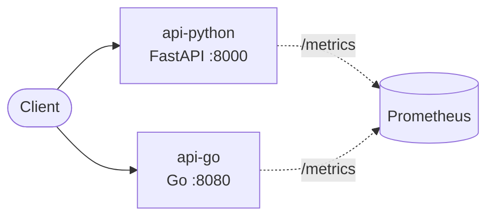

# Architecture

> Keep this page current: update it in the same pull request that changes the architecture.

## Context

What problem the system solves, for whom, and what is out of scope.

## Overview

## Components

| Component | Responsibility | Tech | Owner |
|---|---|---|---|
| `api-python` | Sample HTTP API | Python 3.13, FastAPI, uvicorn | @codewithmuh |
| `api-go` | Sample HTTP API | Go 1.27, net/http | @codewithmuh |

## Runtime contract (every service)

| Concern | How |
|---|---|
| Liveness | `GET /healthz` — process is up; never checks dependencies |
| Readiness | `GET /readyz` — 503 until started and during shutdown |
| Metrics | `GET /metrics` — Prometheus: `http_requests_total`, `http_request_duration_seconds` |
| Logs | One JSON line per event on stdout, with `request_id` |
| Shutdown | On SIGTERM: fail readiness, drain in-flight requests (≤ 20 s), exit 0 |
| Config | Environment variables only; secrets from the platform's secret manager |
| Security | Non-root user, read-only filesystem, no capabilities, minimal base image |

## Data

Stores, schemas, retention and backup/restore.

## Deployment

Environments, how a change reaches production, and how to roll back.

## Reliability

SLOs (SLI, target, window), alerts and the runbook each one links to.

## Security

Trust boundaries and controls — see [threat-model.md](threat-model.md).

## Decisions

See [adr/](adr/).
