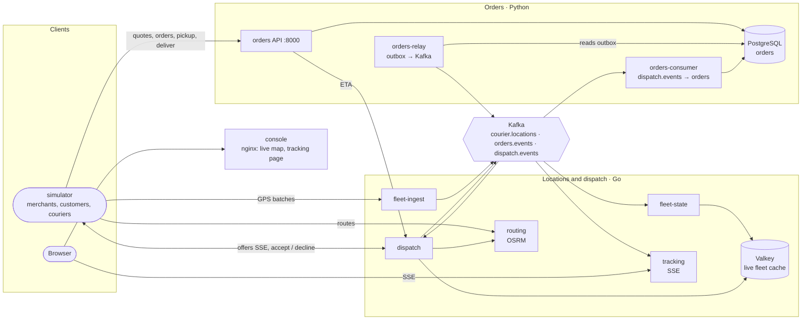
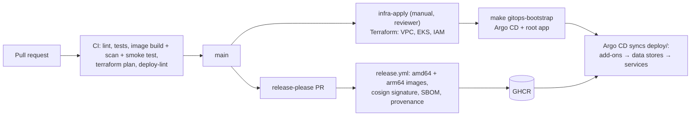

# Architecture

> Keep this page current: update it in the same pull request that changes the architecture.

## Context

This page describes **what is built today** (P1, in progress). The target design for the whole platform, including
scale assumptions, failure modes, SLOs and scope, is in [design.md](design.md). The agreements between services
(events, HTTP shapes, Redis keys) are in [contracts/README.md](../contracts/README.md).

## Overview

## Components

| Component | Responsibility | Tech | Code | Probes / metrics |
|---|---|---|---|---|
| `orders` | Merchants, API keys, stores, couriers, quotes, idempotent orders, order state machine, admin (seeding) API | Python 3.13, Django 5.2 + DRF, gunicorn | [services/orders](../services/orders/) | :8000 |
| `orders-relay` | Publishes outbox rows to `orders.events` (at-least-once, ordered per order) | same image, `manage.py relay_outbox` | 〃 | :9100 |
| `orders-consumer` | Applies `dispatch.events` (assignment, no courier) exactly once per event | same image, `manage.py consume_dispatch_events` | 〃 | :9100 |
| orders migrations, cleanup | `migrate` before each deploy (Compose one-shot, Argo CD PreSync Job); hourly `purge_expired` (CronJob, cluster only) | same image | 〃 | |
| `fleet-ingest` | Courier-authenticated GPS batches → `courier.locations`; sheds load with 503 + `Retry-After` | Go 1.27, franz-go | [services/fleet](../services/fleet/) | :8080 |
| `fleet-state` | Newest point per courier in Valkey, geo sets, sweeper, rebuild from the log, location history | Go | 〃 | :8080 |
| `tracking` | Server-sent events: one order for customers, the whole fleet for the console; reads Kafka, never Valkey | Go | 〃 | :8080 |
| `dispatch` | P1 greedy matching: ETAs for quotes, offers to couriers over SSE, `dispatch.events` | Go | 〃 | :8080 |
| `routing` | Road travel times and routes on Tokyo's 23 wards (bicycle profile, MLD) | OSRM v26.10 | [services/routing](../services/routing/) | :5000 (see exceptions) |
| `simulator` | Deterministic city: seeds tenants and couriers, Poisson demand, couriers riding OSRM routes, weather | Go | [services/simulator](../services/simulator/) | :8080 |
| `console` | Dispatcher's live map (`/`) and customer tracking page (`/track/:token`), EN/JA | React, TypeScript, MapLibre, nginx-unprivileged | [services/console](../services/console/) | :8080 (see exceptions) |
| `rollout-gate` | Answers "may this service start a canary?" from its SLO error budget | Go | [tools/rollout-gate](../tools/rollout-gate/) | :8080 |

All images are published as `ghcr.io/codewithmuh/tasuki-delivery-platform/<component>` (amd64 and arm64, signed,
with SBOM and provenance) by [release.yml](../.github/workflows/release.yml). Owner of every component:
[@codewithmuh](https://github.com/codewithmuh).

## Runtime contract (every service)

| Concern | How |
|---|---|
| Liveness | `GET /healthz`: the process is up; never checks dependencies |
| Readiness | `GET /readyz`: 503 until started (including any replay from Kafka) and during shutdown |
| Metrics | `GET /metrics`: Prometheus, `http_requests_total{method,route,status}`, `http_request_duration_seconds` (route pattern, never the raw path) |
| Logs | One JSON line per event on stdout, with `request_id`; tokens and personal data are never logged |
| Shutdown | On SIGTERM: fail readiness, drain in-flight requests (≤ 20 s, `SHUTDOWN_TIMEOUT`), exit 0 |
| Config | Environment variables only; secrets from AWS Secrets Manager (cluster) or `.env` (local) |
| Security | Non-root user, read-only root filesystem with a writable `/tmp`, no capabilities, minimal base image |

Documented exceptions:

| Component | Exception | Why |
|---|---|---|
| `routing` | No `/healthz`, `/readyz` or `/metrics`; probes call `GET /nearest/v1/bicycle/139.7016,35.6580` (Shibuya), which answers 200 once the graph is loaded. Logs are OSRM's own | Upstream OSRM, unmodified |
| `console` | `/healthz` and `/readyz` are static 200s; no `/metrics` (nginx `stub_status` on `127.0.0.1:8081` for a future exporter sidecar); stops on SIGQUIT | Static files, no dependencies |
| `orders-relay`, `orders-consumer` | Probes and metrics on `WORKER_METRICS_PORT` (9100); `/healthz` is a loop heartbeat | Not web processes |
| `fleet-ingest` | Readiness does not depend on Kafka | Unready replicas would make the load balancer refuse connections instead of answering 503 + `Retry-After` |
| `orders` | Readiness fails on PostgreSQL only after `READINESS_DB_GRACE_SECONDS` (120 s), and never before the first successful check; requests during an outage get `503 database_unavailable` + `Retry-After` | A failover then shows up as counted 503s in the availability SLO instead of an empty Service that the SLI can't see |
| `simulator` | Shutdown first lets couriers finish deliveries in hand (`DRAIN_TIMEOUT`), so it needs a longer grace period (40 s) | Load tests end cleanly |

## Data

| Store | Holds | Retention | Local (Compose) | Cluster (deploy/) |
|---|---|---|---|---|
| PostgreSQL `orders` | Tenants, keys (hashed), stores, couriers, quotes, orders, order events, outbox, idempotency records, processed event IDs | Idempotency records and quotes 24 h; published outbox rows purged hourly; orders kept (PII deletion after 90 days is designed, not built) | `postgres:17`, named volume | CloudNativePG, PostgreSQL 18.6 (dev 1 instance, prod 2). **Backups not configured yet** |
| Kafka | `courier.locations` (key `courier_id`), `orders.events`, `dispatch.events` (key `order_id`); 12 partitions each | 24 h for locations, 7 days for the others | `apache/kafka:4.3.1`, single KRaft node, topics made by `kafka-init` | Strimzi, Kafka 4.3.1, KRaft (dev 1 node, prod 3) |
| Valkey (Redis protocol) | `courier:{id}`, `geo:couriers:*`, `couriers:last_seen`, `fleet:state:rebuilt_at` | TTL 10 min per courier; no persistence | `valkey/valkey:9.0.6-alpine` | Same image, one StatefulSet replica |
| Location history | GPS points as gzipped NDJSON, partitioned by day and hour | Local disk (best effort) in P1 | tmpfs, discarded | Off (`HISTORY_DIR` unset); S3 Parquet is designed, not built |

- **Valkey is a cache derived from Kafka.** Losing it costs seconds: fleet-state replays the last 5 minutes of
  `courier.locations`. Tracking never reads it, so a Valkey outage cannot stop tracking.
- **Personal data** (customer name, phone, address) is encrypted per field with Fernet (`ORDERS_FIELD_KEY`) and never
  appears in events (coordinates only), logs, API responses or idempotency records. Design §11 targets KMS envelope
  encryption.
- **Local differences from the cluster:** PostgreSQL 17 locally and in CI against 18.6 in the cluster; one Kafka
  node; no backups anywhere yet.

## Deployment

1. **Infrastructure:** Terraform in [infra/](../infra/). `bootstrap/` once per account (state bucket, GitHub OIDC
   roles, budget); `platform/` per working session (`make aws-up` / `make aws-down`, about $0.30 an hour while up).
2. **Cluster contents:** [deploy/bootstrap/bootstrap.sh](../deploy/bootstrap/bootstrap.sh) installs Argo CD and
   hands it [deploy/](../deploy/) (app of apps, sync waves): Karpenter, AWS Load Balancer Controller, External
   Secrets, Kyverno, kube-prometheus-stack, Loki, Tempo, OpenTelemetry Collector, Strimzi, CloudNativePG, then the
   `tasuki-dev` and `tasuki-prod` namespaces with their data stores, then every service from one Helm chart. The
   secrets `tasuki/<env>/app` must exist in Secrets Manager first.
3. **A release** is a merged release-please PR: every image gets the same version, built natively for amd64 and
   arm64, signed keylessly by `release.yml` on `refs/heads/main`. Promotion is a pull request that changes
   `image.tag` in `deploy/apps/overlays/dev`, then `prod`. GHCR packages must be public, or the namespaces need an
   image pull secret.
4. **Rollback:** revert the promotion PR; Argo CD syncs the previous tag. Canary releases through Argo Rollouts, gated
   by the rollout gate, are designed ([tools/rollout-gate](../tools/rollout-gate/)) but Argo Rollouts is not
   installed yet.
5. **Local:** `make up` runs the same images with the same hardening in Docker Compose ([README](../README.md#quick-start-local-stack)).

Not deployed to the cluster yet: `console` and `rollout-gate` (no values in `deploy/apps/services/`).

## Reliability

| What | Where |
|---|---|
| SLOs: orders availability and latency, location freshness, tracking freshness, dispatch assignment speed | [observability/slo](../observability/slo/README.md) (Sloth specs → generated rules, promtool tests) |
| Burn-rate and cause alerts, each with a runbook | [observability/alerts](../observability/alerts/README.md), [runbooks/](runbooks/) |
| What happens when a budget runs out | [slo/error-budget-policy.md](slo/error-budget-policy.md), enforced by the [rollout gate](../tools/rollout-gate/) |
| Dashboards as code | [observability/dashboards](../observability/dashboards/README.md) |
| Failure modes and degradation | [design.md §10](design.md#10-failure-modes-and-degradation) |
| Game days | [gameday/](gameday/) (plans; no drill run yet) |

## Security

Trust boundaries, controls and accepted risks: [threat-model.md](threat-model.md).

## Decisions

See [adr/](adr/) and the list of decisions still to record in [design.md §14](design.md#14-decisions-to-record).
