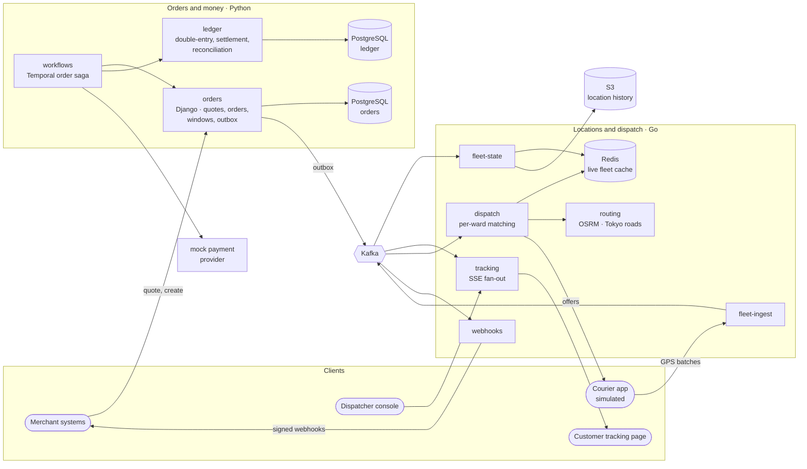
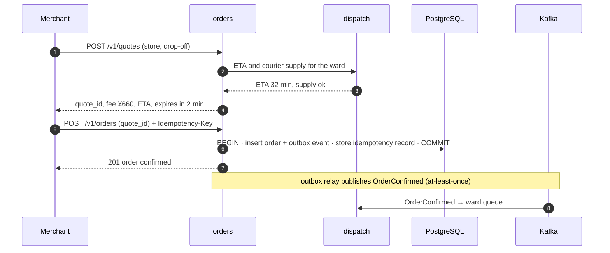
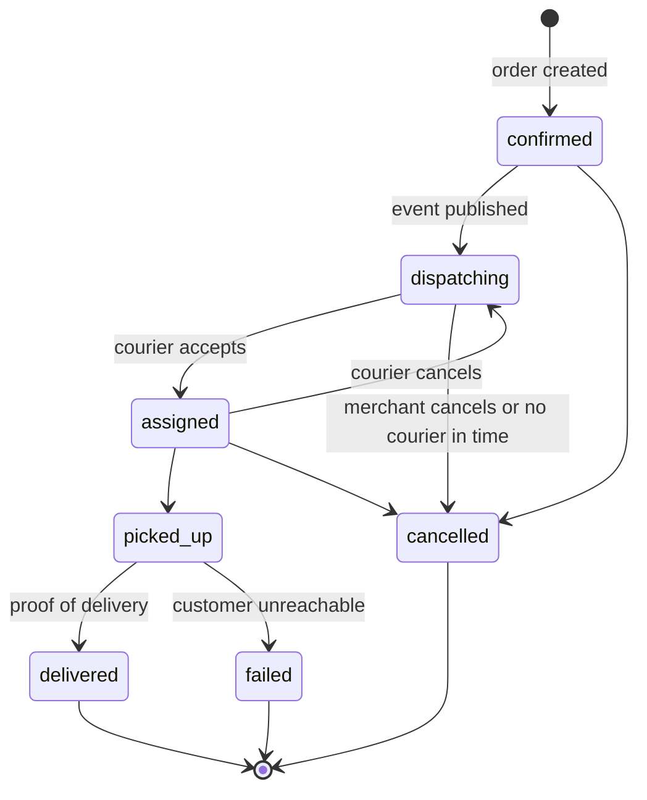

# Tasuki: system design

- Status: **Draft** (under review by the owner)
- Owner: Muhammad Rashid ([@codewithmuh](https://github.com/codewithmuh))
- Last updated: 2026-10-14

> **Tasuki is a fictional company.** Every merchant, courier, customer and order in this repository is simulated.
> The engineering is real: the services, the platform, the SLOs, the load tests and the incidents all run for real.

This document designs the **whole platform**. The repository builds a thin slice through every hard problem in it,
and §13 lists exactly what is built, stubbed or left out. Decisions marked **ADR** are recorded in [adr/](adr/).

**How to read it:** §1–5 cover what we build and why. §6–10 cover how it works and how it fails. §11–14 cover security,
the platform, the build plan and the open decisions.

---

## 1. Context

Tasuki (襷, the sash that ekiden relay runners hand to each other) is a **delivery-as-a-service platform for Tokyo's
23 wards**. Restaurants, grocers and shops ("merchants") send delivery requests through an API. Tasuki quotes a
price and an arrival time, assigns a freelance courier on a bicycle or scooter, shows the delivery live to the
customer and the merchant, charges the merchant, and pays the courier every week.

Like the relay sash, every order is handed on: merchant → dispatch → courier → customer. The platform's job is to
make sure the sash is never dropped, never handed to two runners, and always visible.

Two delivery products:

| Product | Promise | Example |
|---|---|---|
| **On-demand** | Delivered within about 30–45 minutes, with a live ETA | Lunch from a ramen shop in Shibuya |
| **Scheduled** (時間帯指定) | Delivered inside a booked 2-hour window | Groceries between 18:00 and 20:00 |

## 2. Goals and non-goals

**Goals**

| # | Goal |
|---|---|
| G1 | Accept orders reliably: never lose one, never charge one twice. |
| G2 | Assign a courier fast and keep the promised ETA honest, including when demand exceeds courier supply. |
| G3 | Show the courier's live position to customers and merchants. |
| G4 | Settle money exactly: every yen is accounted for, and reconciliation balances to zero. |
| G5 | Degrade gracefully under surges and partial failures instead of falling over. |
| G6 | Keep personal data in Japan and keep as little of it, for as short a time, as possible. |
| G7 | Be operable by a small team: one platform, GitOps, written SLOs, runbooks for every alert. |

**Non-goals**

- A consumer storefront, menus or carts. Merchants own their storefronts; Tasuki is the logistics layer.
- Real payments, real bank transfers, real courier onboarding/KYC. A mock payment provider stands in, with
  configurable failures.
- Native courier or customer apps. The simulator plays the courier app through the same public APIs.
- Multi-drop van route optimisation (the vehicle routing problem).
- Multi-region active-active. Disaster recovery is designed (§10) but not built.

## 3. Actors and journeys

| Actor | Uses | Main journeys |
|---|---|---|
| Merchant | Partner API, webhooks | J1 get a quote and create a delivery · J6 receive status webhooks |
| Customer | Tracking page (link by SMS) | J2 book a delivery window · J5 watch the courier live · tip the courier |
| Courier | Courier app (simulated) | J3 receive and accept offers · J4 pick up, deliver, prove delivery |
| Dispatcher | Ops console | Watch the city, intervene on stuck orders |
| Finance | Reports | J7 weekly merchant statements and courier payouts |

## 4. Scale assumptions

These are **assumptions** for a mid-size Tokyo operator. They exist so every design choice below has a number behind it.

| Quantity | Assumption | Derived |
|---|---|---|
| Orders | 50,000 per day; the busiest hour carries 12 % of the day | 6,000/h ≈ **1.7 orders/s** at normal peak |
| Rain surge | Demand ×3 on a rainy Friday lunch | ≈ **5 orders/s**; designed with ×4 headroom → 20 orders/s |
| Couriers | 3,000 online at peak, ~1,500 on average over 14 operating hours | |
| Courier capacity | ~30 min per delivery cycle, 1.2 orders per trip with stacking | ≈ 2.4 deliveries per courier-hour → **7,200 deliveries/h** at peak |
| GPS updates | Every 4 s when moving with an order; every 15 s when idle | **750 updates/s** at peak; ~13 M points/day |
| Orders in flight | Little's law: 1.7 orders/s × 1,800 s | ≈ **3,000** concurrent deliveries |
| Tracking viewers | ~60 % of customers and merchant screens watch | ~3,600 concurrent; designed for **10,000** SSE connections |
| Ledger postings | ~5 postings per delivered order | ~250,000/day, ~90 M/year |
| Location history | ~150 B per point as JSON; ~10× smaller as Parquet + zstd | ~2 GB/day raw → ~0.2 GB/day stored |

Two conclusions shape everything else:

1. **A rain surge is a capacity problem, not a throughput problem.** At ×3 demand, orders want 18,000 deliveries/h
   but couriers can do about 7,200. The servers can easily take 5 orders/s. What breaks is the promise. So the system's
   job in a surge is to **quote honestly** (longer ETAs, fewer bookable windows, a surge fee) and stay up.
2. **Orders are few and precious; locations are many and disposable.** That difference gets its own section.

## 5. Two systems with different rules

| | Orders and money | Locations and tracking |
|---|---|---|
| Volume | Single-digit writes/s, even in a surge | ~750 writes/s at peak |
| What "correct" means | Exactly-once effects: no lost order, no double charge, ledger balances | Latest wins: a missed or late GPS point is harmless if the next one arrives |
| Source of truth | PostgreSQL (ACID), append-only ledger | Kafka log; Redis is a cache rebuilt from it |
| Consistency | Strong inside a service; sagas across services | Eventual, within seconds |
| On failure | Reject or queue, never guess | Serve the last known position and say how old it is |
| SLO style | Availability, latency, correctness | Freshness, completeness |
| Language | Python / Django: rich domain model, transactions, admin tooling | Go: high throughput, small memory, cheap concurrency |

Most of the architecture follows from keeping these two worlds apart. A failure in the location path must never stop
orders, and the order path must never trade correctness for speed.

## 6. Architecture



### Components

| Component | Responsibility | Tech | Built in |
|---|---|---|---|
| `orders` | Merchants (tenants), API keys, quotes, orders, delivery windows, order state machine, transactional outbox | Python, Django + DRF, PostgreSQL | P1 (basic) → P3 |
| `ledger` | Accounts, double-entry postings, merchant statements, courier payouts, daily reconciliation | Python, PostgreSQL | P3 |
| `workflows` | The order saga: authorise → dispatch → deliver → capture → post to ledger, with compensation | Temporal, Python workers | P3 |
| `fleet-ingest` | Authenticated GPS batch endpoint for couriers; validation, dedupe, publish to Kafka | Go | P1 |
| `fleet-state` | Latest position and status per courier in Redis, GEO index for nearest-courier queries; writes history to S3 | Go, Redis | P1 |
| `dispatch` | Per-ward matching of orders to couriers, offers with timeouts, ETA quotes | Go, OSRM | P1 (greedy) → P3 (batched optimal) |
| `tracking` | Live position stream for customers, merchants and the console (server-sent events) | Go | P1 |
| `webhooks` | Signed, retried merchant webhooks with dead-letter queue and replay | Go | P3 |
| `routing` | Road travel times on real Tokyo streets (OpenStreetMap Kantō extract) | OSRM (MLD) | P1 |
| `simulator` | The city: merchants, customers, couriers, demand curves, rain | Go | P1 |
| `console` | Live dispatcher map and customer tracking page (EN/JA) | React, MapLibre | P1 (minimal) |
| `copilot` | Ops assistant that explains late orders using read-only tools | LLM gateway + MCP (separate repo) | P2 |

### Event streams

| Topic | Key | Producer → consumers | Delivery |
|---|---|---|---|
| `courier.locations` | `courier_id` | fleet-ingest → fleet-state, tracking, dispatch | At-least-once; consumers keep the newest point per courier |
| `orders.events` | `order_id` | orders (outbox relay) → dispatch, webhooks, workflows | At-least-once; consumers dedupe on `event_id` |
| `dispatch.events` | `order_id` | dispatch → orders, tracking, webhooks | At-least-once; consumers dedupe on `event_id` |

Keying by `courier_id` and `order_id` keeps events for one courier or one order in order. 750 messages/s is small
for Kafka, so partition counts (12) are chosen for consumer parallelism, not throughput.

## 7. Key flows

### 7.1 Create an on-demand order



- **Idempotency:** the `Idempotency-Key` and a hash of the request body are stored with the response for 24 h.
  A retry with the same key returns the original response; the same key with a different body returns `422`.
- **Transactional outbox:** the order and its event are written in one transaction, so an order can never exist
  without its event, or the event without the order. A relay publishes outbox rows to Kafka (**ADR**: polling relay
  vs Debezium CDC).
- **Quotes expire** after 2 minutes, so a merchant cannot lock in a pre-surge price during a surge.

### 7.2 Location → dispatch → tracking

1. The courier app sends GPS points in batches (every 4 s when moving with an order, every 15 s when idle).
2. `fleet-ingest` checks the courier token, drops malformed points and points stamped more than 30 s in the future,
   and publishes them to `courier.locations`.
3. `fleet-state` keeps the newest point per courier in Redis (older points are ignored, so out-of-order delivery is
   harmless), indexes couriers with Redis GEO sets for "nearest available courier" queries (H3 cells arrive with
   batched dispatch in P3), and appends history to S3 as hourly Parquet files.
4. `tracking` reads the location stream directly from Kafka and pushes updates to the viewers it holds. At 750
   messages/s, each replica reading the whole stream is cheaper and simpler than per-courier pub/sub, and it means a
   Redis outage cannot stop tracking (**ADR**).
5. Redis is a **cache derived from the log**. If it is lost, `fleet-state` rebuilds it by replaying the last few
   minutes of `courier.locations`, which takes seconds.

### 7.3 Dispatch

- **Zones are the 23 wards.** Each ward is matched by exactly one `dispatch` replica at a time, which holds a
  Kubernetes `Lease` for it. If a replica dies, its leases expire (15 s) and other replicas take the wards over.
- **Fencing:** each lease carries an epoch. Offers are written with that epoch, and writes from an older epoch are
  rejected, so a replica that lost its lease (for example during a long GC pause) cannot create double offers.
- **P1, greedy:** each new order goes to the nearest available courier by road time (OSRM).
- **P3, batched:** every 5 s per ward, pending orders are matched against available couriers in the ward plus
  neighbouring H3 cells. The cost is road time to the store, plus a penalty for arriving before the food is ready
  or after the promised time. The minimum-cost assignment is solved with the Hungarian algorithm (a batch is at
  most a few dozen orders, so O(n³) is fine).
- **Offers** expire after 30 s. A declined or expired offer returns the order to the pool with higher priority.

### 7.4 Scheduled delivery windows

A window's capacity per ward is *expected couriers × deliveries per courier-hour × 2 h × safety factor*. Booking is one
conditional update, with no lock held across network calls, so it cannot overbook under concurrent load:

```sql
UPDATE delivery_window
SET    booked = booked + 1
WHERE  id = $1 AND booked < capacity
RETURNING booked;
```

A booking is a **hold** for 10 minutes until the order is confirmed. Expired holds are released by a sweeper.

### 7.5 Money

- Amounts are **integer yen** (`bigint`). JPY has no minor unit, so there are no fractions to round.
- Merchants pay a delivery fee per order: the card on file is authorised when the order is confirmed and captured
  on delivery. The authorisation is voided if the order is cancelled before pickup; a cancellation fee applies after.
- Customers can tip the courier from the tracking page; 100 % of the tip goes to the courier.
- Every money movement is a **balanced journal entry**: the postings sum to zero, in one transaction. Consumption
  tax (10 %) is posted separately so merchant statements can follow the qualified-invoice format (インボイス制度).

Example: delivery fee ¥660 (¥600 + ¥60 tax), courier earns ¥450, tip ¥200.

| Event | Debit | Credit |
|---|---|---|
| Delivered: fee captured | `psp_receivable` 660 | `platform_revenue` 150 · `courier_payable:C42` 450 · `tax_payable` 60 |
| Tip captured | `psp_receivable` 200 | `courier_payable:C42` 200 |
| Payment provider settles (fee 3.6 % ≈ ¥31) | `bank` 829 · `psp_fees` 31 | `psp_receivable` 860 |
| Weekly payout | `courier_payable:C42` 650 | `bank` 650 |

- **Daily reconciliation:** the ledger is checked against the payment provider's settlement file and the payout
  file. Every mismatch becomes an exception for finance. The invariant "all postings sum to zero" is checked
  continuously.
- Couriers are paid weekly, well inside the 60-day limit set by Japan's 2024 freelance law.

## 8. Data model (core)



| Store | Main tables / keys |
|---|---|
| `orders` DB | `merchant`, `api_key`, `store` (location, H3 cell), `order`, `order_event` (append-only history), `delivery_window`, `window_hold`, `idempotency_record`, `outbox` |
| `ledger` DB | `account`, `journal_entry`, `posting` (signed yen amount), `statement`, `payout`, `reconciliation_exception` |
| `dispatch` | `offer` (order, courier, ward, epoch, expires_at) |
| Redis | `courier:{id}` → position, status, timestamp · `geo:couriers:available` and `geo:couriers:all` → GEO sets (see [contracts](../contracts/README.md)) |
| S3 | `locations/dt=YYYY-MM-DD/hour=HH/*.parquet` · database backups · OSRM data |

IDs are ULIDs: sortable by time, safe to generate in any service, and not guessable.

## 9. SLOs

| SLO | SLI | Target | Window |
|---|---|---|---|
| Order API availability | Share of quote and create requests that do not return 5xx | 99.9 % (≈ 40 min of budget) | 28 days |
| Order API latency | Share of create requests faster than 300 ms | 95 % | 28 days |
| Ledger correctness | Daily reconciliations that balance | 100 % (any imbalance pages) | daily |
| Location freshness | Share of GPS points visible in `fleet-state` within 2 s of receipt | 99 % | 28 days |
| Tracking freshness | Share of position events younger than 10 s when they reach the viewer | 99 % | 28 days |
| Dispatch speed | Share of on-demand orders with an accepted courier within 60 s | 95 % (operating hours) | 28 days |
| Webhook timeliness | Share of webhooks whose first attempt is sent within 10 s of the event | 99 % | 28 days |
| ETA accuracy (business) | Share of on-demand deliveries within ±5 min of the ETA given at confirmation | 80 % | 28 days |

- **Alerting** uses multi-window, multi-burn-rate rules (Google SRE Workbook). It pages at 14.4× burn over 1 h and
  5 min, or 6× over 6 h and 30 min, and opens a ticket at 1× over 3 days and 6 h. ETA accuracy only ever opens tickets.
- **The error-budget policy** decides what happens when a budget runs out: feature deploys freeze, and the Go rollout
  gate blocks Argo Rollouts canaries for that service until the budget recovers. It lives in
  `docs/slo/error-budget-policy.md`.
- Every alert links to a runbook in [runbooks/](runbooks/).

## 10. Failure modes and degradation

| Failure | What users see | Design response |
|---|---|---|
| Redis lost | Nothing for orders or tracking; new assignments pause for seconds | Tracking reads Kafka, not Redis. `fleet-state` rebuilds Redis by replaying recent locations. Dispatch waits for the rebuild. |
| Kafka unavailable | Orders still accepted; status updates delayed | Outbox rows wait in PostgreSQL and drain later. `fleet-ingest` sheds load with `503 Retry-After`, and courier apps resend their next batch (lossy is fine here). |
| OSRM down | ETAs slightly less accurate | Dispatch falls back to straight-line distance × a Tokyo detour factor, and quotes widen. |
| PostgreSQL primary fails | Order creation fails for 1–2 minutes | Multi-AZ failover. Clients get `503 Retry-After`; idempotency keys make their retries safe. |
| Payment provider slow or down | Merchants in good standing unaffected | Circuit breaker. Authorisation is retried by the saga and the order proceeds, so the business carries a small, bounded credit risk. Merchants on probation are refused. |
| Dispatch replica dies | Up to ~15 s extra wait in its wards | Leases expire and move; epochs fence the old owner. |
| Rain surge (×3 demand) | Longer ETAs, fewer windows, surge fee | Quotes reflect courier supply. Karpenter adds spot nodes (on-demand fallback). Priority load shedding: orders > dispatch > tracking > history. Tracking drops to 10 s updates (brownout). |
| One AZ lost | Brief retries | Pods spread across 3 AZs with PDBs; Multi-AZ database; Kafka replication factor 3, min in-sync 2. |
| Region lost (designed, not built) | Outage until failover | Backups and Kafka-derived history copied to Osaka (ap-northeast-3), so data stays in Japan. Target RPO 15 min, RTO 4 h. |

Every row above becomes a game-day experiment, and two of them become written postmortems (P1).

## 11. Security and privacy

- **Data residency:** all data and backups stay in Tokyo (ap-northeast-1); disaster-recovery copies go only to Osaka.
  Keeping personal data in Japan simplifies compliance with APPI, Japan's personal-information law, and matches
  what Japanese merchants expect.
- **Data minimisation:** customer name, phone and address are encrypted per field (AWS KMS envelope encryption).
  Couriers see the address only after accepting. Phone calls are masked. Personal data is deleted 90 days after
  delivery; the ledger keeps only order IDs.
- **Tenancy:** every merchant is a tenant with its own OAuth2 client credentials. Every query is scoped to the
  tenant, and rate limits are per tenant, so one noisy merchant cannot slow the rest.
- **Tracking links** are signed and single-order. They expire 24 h after the promised delivery time (a signed link
  can't know the actual delivery time when it is issued), and the stream itself ends at delivery.
- **Webhooks** are signed with HMAC-SHA256 over a timestamp and the body, with a 5-minute replay window. Two secrets
  stay active during rotation.
- **Platform:**
  - Kyverno policies: no `:latest` tags, limits required, only signed images from this repo
  - Pod Security "restricted" and default-deny NetworkPolicies
  - Per-service IAM through Pod Identity; secrets from AWS Secrets Manager through External Secrets
  - Trivy scans, SBOMs, keyless cosign signatures
- The STRIDE review is in [threat-model.md](threat-model.md).

## 12. Platform and delivery

- **AWS ap-northeast-1, 3 AZs.** EKS with Karpenter (spot first), all provisioned by Terraform with remote state.
  GitHub Actions reaches AWS through OIDC, so there are no stored keys.
- **GitOps:** Argo CD app-of-apps, Helm charts with Kustomize overlays. Canary releases through Argo Rollouts,
  checked against SLO metrics and the error-budget gate.
- **Observability:** OpenTelemetry in every service → Prometheus (metrics), Loki (logs), Tempo (traces). Grafana
  dashboards and alert rules live in git.
- **Environments:** local (Docker Compose and kind), and one EKS cluster with `dev` and `prod` namespaces to keep
  cost down. A real company would use separate AWS accounts and clusters per environment (**ADR**).
- **Cost:** under $8 a day while running; `make aws-down` returns it to $0 apart from the Terraform state bucket.

## 13. What this repository builds

| Area | Status | Notes |
|---|---|---|
| Platform: EKS, Karpenter, GitOps, observability, SLOs, rollout gate | **P1** | Full depth |
| `orders`: tenants, quotes, on-demand orders, idempotency, outbox | **P1** | Scheduled windows and payments added in P3 |
| `fleet-ingest`, `fleet-state`, `tracking` | **P1** | Full depth |
| `routing` (OSRM on Tokyo roads) | **P1** | |
| `dispatch` | **P1** greedy → **P3** batched | Lease-based ward ownership with fencing in P3 |
| `simulator` | **P1** | Deterministic seeds so load tests are repeatable |
| `console` | **P1** minimal | Live map and tracking page |
| `workflows` (Temporal saga), `ledger`, reconciliation, payouts | **P3** | |
| `webhooks`, partner OAuth2 API, delivery windows | **P3** | |
| `copilot` (ops assistant) | **P2** | Separate repo, deployed here |
| Payment provider, SMS, bank payouts | **Stubbed** | Mocks with failure injection |
| Courier/customer apps, KYC, merchant onboarding UI, multi-region, VRP | **Not built** | Out of scope; see §2 |

In P1 the order lifecycle is a plain state machine inside `orders`. It moves into a Temporal workflow in P3, once
payments create steps that need compensation. That staged evolution is deliberate.

## 14. Decisions to record

Each becomes an ADR in [adr/](adr/), written by the owner as the work reaches it.

| ADR | Question | Options |
|---|---|---|
| 0002 | Where do the services run? | EKS · ECS Fargate (the owner's production background) |
| 0003 | Which language for which service? | Python/Django for orders and money, Go for the location path · one language for all |
| 0004 | How do we run Kafka? | Strimzi on EKS · Redpanda · Amazon MSK |
| 0005 | How do we run PostgreSQL? | RDS Multi-AZ · CloudNativePG on EKS |
| 0006 | How do outbox events reach Kafka? | Polling relay · Debezium CDC |
| 0007 | How do we coordinate the order saga? | Temporal · AWS Step Functions · choreography with events |
| 0008 | How do we index couriers in space? | H3 · geohash · PostGIS |
| 0009 | How does tracking reach browsers? | Server-sent events · WebSockets |
| 0010 | Does tracking read Kafka directly or Redis pub/sub? | Full stream per replica · per-courier channels |
| 0011 | GitOps tool | Argo CD · Flux |
| 0012 | Node autoscaling | Karpenter · Cluster Autoscaler |
| 0013 | Policy engine | Kyverno · OPA Gatekeeper |
| 0014 | Secrets | External Secrets + Secrets Manager · Sealed Secrets · Vault |
| 0015 | SLO tooling | Sloth · Pyrra · hand-written rules |
| 0016 | Environments | One cluster with namespaces · a cluster per environment |
| 0017 | Money representation | Integer yen + double-entry ledger · balances on rows |
| 0018 | Where does Terraform stop and GitOps start? | Terraform for AWS only, Argo CD for everything in the cluster · Terraform installs cluster add-ons too |
| 0019 | NAT gateways in dev | One shared NAT gateway · one per AZ |

## 15. Open questions

- Should couriers carry stacked orders from different merchants in P3, or only from the same store?
- Should tracking links use a signed JWT or an opaque token looked up in Redis?
- Is the payment provider's credit-risk trade-off in §10 acceptable, and what is the per-merchant limit?
- What surge-fee formula keeps ETAs honest without driving merchants away? (Needs simulator experiments.)
