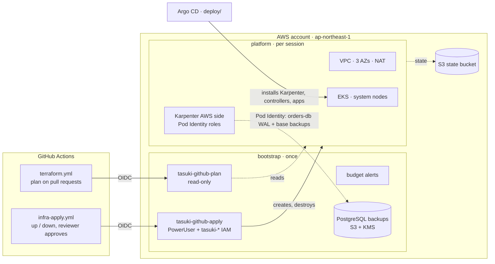

# infra: AWS for Tasuki (Terraform)

Two Terraform stacks put Tasuki on AWS in Tokyo (ap-northeast-1). Terraform owns **AWS resources only**.
Everything that runs inside the cluster, including the Karpenter controller and its NodePools, is
installed by Argo CD from [deploy/](../deploy/). The platform is built to be **created and destroyed in
one session**: `make aws-up` before working on it, `make aws-down` after, so it only costs money while in use.

| Stack | Creates | Run |
|---|---|---|
| [bootstrap/](bootstrap/) | GitHub OIDC provider, CI roles `tasuki-github-plan` (read-only) and `tasuki-github-apply`, monthly budget alerts, and the [PostgreSQL backup bucket](#postgresql-backups) with its KMS key (both outlive the platform). The S3 state bucket is made by [scripts/create-state-bucket.sh](scripts/create-state-bucket.sh). | Once per account: `make aws-bootstrap` (again after this stack changes) |
| [platform/](platform/) | VPC (3 AZs, public / private / intra subnets, 1 NAT gateway, S3 gateway endpoint, flow logs), EKS with KMS-encrypted Secrets and a small Graviton "system" node group, the AWS side of Karpenter (roles, spot-interruption queue), Pod Identity roles for the EBS CSI driver, AWS Load Balancer Controller, External Secrets and the orders-db backups | Each session: `make aws-up` / `make aws-down` |



## Prerequisites

- A **personal AWS account used only for Tasuki**, with an AWS CLI profile for it (IAM Identity Center
  recommended: `aws configure sso --profile tasuki`). Never the machine's default identity.
- Terraform ≥ 1.10 (CI uses 1.16.5), AWS CLI v1 or v2, kubectl, curl, jq.
- For `make infra-check`: tflint, trivy and checkov (`CHECKOV="uvx checkov"` works too).

## First-time setup

1. Select the account. Every `aws-*` target stops unless both are set and the logged-in account matches:

   ```bash
   export AWS_PROFILE=tasuki
   export TASUKI_ACCOUNT_ID=123456789012   # your account ID
   ```

2. Create both tfvars files (git-ignored) from their examples:
   - `infra/bootstrap/terraform.tfvars`: `budget_alert_email`.
   - `infra/platform/terraform.tfvars`: `admin_principal_arns`, your own IAM role or user, which gets
     cluster-admin. For an IAM Identity Center role, use the ARN including its path:
     `aws iam list-roles --path-prefix /aws-reserved/sso.amazonaws.com/ --query 'Roles[].Arn' --output text`.
     For an IAM user: `aws sts get-caller-identity --query Arn --output text`.

3. Create the state bucket, the CI roles and the budget. Terraform shows its plan and asks before applying:

   ```bash
   make aws-bootstrap
   ```

4. In GitHub, **Settings → Secrets and variables → Actions → Variables**, add:

   | Variable | Value |
   |---|---|
   | `AWS_ACCOUNT_ID` | the 12-digit account ID |
   | `AWS_PLAN_ROLE_ARN` | output `plan_role_arn` |
   | `AWS_APPLY_ROLE_ARN` | output `apply_role_arn` |
   | `TF_STATE_BUCKET` | output `state_bucket` |
   | `API_ALLOWED_CIDRS` | CIDRs that may reach the Kubernetes API, as JSON: `["203.0.113.7/32"]` |
   | `CLUSTER_ADMIN_ARNS` | the same list as `admin_principal_arns`, as JSON |
   | `INFRACOST_ENABLED` | optional: `true`, plus the secret `INFRACOST_API_KEY` (free key from `infracost auth login`) |

   With the GitHub CLI, for example: `gh variable set AWS_PLAN_ROLE_ARN --body "$(terraform -chdir=infra/bootstrap output -raw plan_role_arn)"`.

5. **Settings → Environments → New environment `aws-tokyo`**: add yourself as a *required reviewer* and
   limit *deployment branches* to `main`. The apply role trusts only jobs in this environment.

Until step 4 is done, the plan job in `terraform.yml` is skipped and only the static checks run.

## Daily use

```bash
make aws-up          # ~15-20 min. Prints the approximate hourly cost, shows the plan, asks before applying
make kubeconfig      # adds context "tasuki" to ~/.kube/config
# ... bootstrap Argo CD (deploy/), work, run load tests ...
make aws-down        # deletes what Kubernetes made, destroys the platform, then checks for leftovers
```

- `make aws-plan` shows what `aws-up` would change. `make aws-leftovers` re-runs the leftover check alone.
- `aws-up` lets only your current public IP reach the Kubernetes API (from checkip.amazonaws.com).
  Set `API_ALLOWED_CIDRS='["203.0.113.0/24"]'` to override.
- From GitHub instead: **Actions → infra-apply → Run workflow**, choose `up` or `down`, then approve the run.

### Why `aws-down` is more than `terraform destroy`

Controllers inside the cluster create AWS resources Terraform does not know about: ALBs and NLBs (AWS Load
Balancer Controller), EBS volumes (EBS CSI driver), EC2 instances and instance profiles (Karpenter). Left
behind, they keep billing and stop `terraform destroy` from deleting the VPC and IAM roles.
[scripts/pre-destroy.sh](scripts/pre-destroy.sh) removes them first, in order: stop Argo CD so it cannot
recreate anything, delete load-balanced Ingresses, Services and Gateways and wait for their load balancers
to go, delete every non-system namespace, wait for EBS-backed volumes to go, delete the Karpenter NodePools
and wait for their nodes, then the EC2NodeClasses. The controllers doing the cleanup run in `kube-system`,
which is never deleted. [scripts/check-leftovers.sh](scripts/check-leftovers.sh) then lists anything
billable still in the region and fails if it finds something.

## PostgreSQL backups

CloudNativePG archives the orders database's WAL continuously and takes base backups on a schedule, through the
Barman Cloud plugin ([deploy/README.md](../deploy/README.md#backups-and-restore)). The bucket is in the
**bootstrap** stack on purpose: `make aws-down` destroys the platform every session, and backups that die with the
cluster are not backups.

| Piece | Where | What |
|---|---|---|
| Bucket `tasuki-pg-backups-<account-id>` | [bootstrap/backups.tf](bootstrap/backups.tf) | Versioned, SSE-KMS with its own key (`alias/tasuki-pg-backups`, rotated yearly, bucket key on), public access blocked, ACLs off, TLS-only bucket policy, `force_destroy = false` |
| Lifecycle | same | Objects expire per prefix: `tasuki-dev/` after 14 days, `tasuki-prod/` after 37 (the Barman retention of 7 and 30 days, plus a week); noncurrent versions after 7 days; incomplete multipart uploads after 1 day; expired delete markers removed |
| Roles `tasuki-dev-orders-db-backup`, `tasuki-prod-orders-db-backup` | [platform/backups.tf](platform/backups.tf) | Pod Identity for ServiceAccount `orders-db` in `tasuki-<env>`: read, write and delete under `tasuki-<env>/` only, KMS through S3 only |
| Roles `tasuki-dev-orders-db-restore`, `tasuki-prod-orders-db-restore` | same | Pod Identity for ServiceAccount `orders-db-restore` (the cluster a restore creates): read-only under `tasuki-<env>/` |
| Session prefix | same, `terraform_data.backup_session` | When the platform was created, e.g. `20261014T0930Z`; outputs `backup_bucket` and `backup_session` go to Argo CD through the GitOps bridge |

Objects land at `s3://tasuki-pg-backups-<account-id>/tasuki-<env>/<session>/orders-db/{base,wals}/`. The session
level exists because CloudNativePG refuses to archive WAL into an archive that already holds another cluster's
WAL, and every `make aws-up` creates the database anew. Each session therefore writes its own path, and the roles
cover the whole environment prefix, so a later session can still restore an earlier one's backups.

- **First time, or on an account bootstrapped before backups existed:** run `make aws-bootstrap` once more. Until
  then `make aws-plan` / `aws-up` stop with an error from the `aws_s3_bucket` data source in `platform/backups.tf`.
- **A new path within a session** (only needed if `orders-db` itself was re-created, so its WAL archive check
  fails): `TF_CLI_ARGS_apply="-replace=terraform_data.backup_session" make aws-up`, then `make gitops-bootstrap`.
- **Deleting the backups** is deliberate: empty the bucket (all versions) by hand, then remove it from
  `bootstrap/backups.tf`. Terraform refuses to delete a bucket that still holds objects.
- `make aws-down` deletes the namespaces before the database can archive its last WAL segment, so up to
  `archive_timeout` (5 minutes) of the session's final writes are not in the bucket.

## Cost (approximate)

**Approximate on-demand prices for ap-northeast-1, for orientation only. Prices change; `make infra-cost`
(Infracost) gives the current figure, and the Infracost job comments the difference on pull requests.**

| Item | Approximate price | Per hour while up |
|---|---|---|
| EKS control plane (standard support) | $0.10/h | $0.100 |
| NAT gateway (one, shared by the 3 AZs) | ~$0.062/h + ~$0.062/GB processed | $0.062 + traffic |
| System nodes, 2 × t4g.medium (Graviton) | ~$0.043/h each | $0.086 |
| Public IPv4: the NAT gateway's Elastic IP | $0.005/h | $0.005 |
| gp3 root volumes, 2 × 30 GiB | ~$0.096/GB-month | ~$0.008 |
| CloudWatch Logs: control-plane and VPC flow logs, kept 7 days | ~$0.76/GB ingested | ~$0.01–0.05 |
| KMS key for Secrets encryption | $1/month per key | ~$0.001 |
| **Total for the base platform** | | **≈ $0.30/hour, ≈ $7/day** |

Not included: Karpenter nodes for the workloads (spot first), load balancers the apps create, EBS volumes
for PersistentVolumes, and data transfer. Destroyed, the platform costs nothing except what outlives it on
purpose: a few cents for the state bucket, and for backups about $1/month for the KMS key plus S3 Standard
storage (~$0.025/GB-month in Tokyo; dev-sized databases stay well under a dollar). Left running for a whole month it would cost about $200, so the $100 monthly budget alert
(50 % and 80 % actual, 100 % forecast) fires first.

## Safety guards

| Guard | Where |
|---|---|
| Terraform refuses any account but `account_id` (`allowed_account_ids`), even when the shell is logged in elsewhere | `*/providers.tf` |
| Every `aws-*` target and script checks the logged-in account against `TASUKI_ACCOUNT_ID` before doing anything; local targets also require `AWS_PROFILE` | `scripts/common.sh`, `mk/infra.mk` |
| The Kubernetes API is public only to `api_allowed_cidrs`; a validation rejects `0.0.0.0/0`. Nodes use the private endpoint | `platform/eks.tf`, `platform/variables.tf` |
| No AWS keys in GitHub: short-lived OIDC credentials. Pull requests get a read-only role; the apply role trusts only the `aws-tokyo` environment (reviewer + `main` only) | `bootstrap/github-oidc.tf` |
| No administrator role in CI: PowerUserAccess, plus IAM only for `tasuki-*` names, a short list of service-linked roles, and an explicit deny on editing the CI roles themselves | `bootstrap/github-oidc.tf` |
| Admins are listed explicitly (EKS access entries, KMS key admins), so whoever applies last never changes who is admin | `platform/eks.tf` |
| Plans posted on public pull requests have the account ID and allowed CIDRs replaced; both are masked in logs | `.github/workflows/terraform.yml` |
| Teardown removes controller-made resources, then fails loudly if anything billable is left; a budget alert backs it up | `scripts/`, `bootstrap/budget.tf` |
| State: versioned, encrypted, TLS-only, private S3 bucket with S3-native locking | `scripts/create-state-bucket.sh` |
| Backups: a bucket Terraform will not delete while it holds objects (`force_destroy = false`), versioned, KMS-encrypted, TLS-only; each environment's role reaches only its own prefix | `bootstrap/backups.tf`, `platform/backups.tf` |

## Checks

`make infra-check` runs the same static checks as CI without touching AWS: `terraform fmt`, `validate`
for both stacks, tflint (with the AWS ruleset, [.tflint.hcl](.tflint.hcl)), trivy and checkov
([.checkov.yaml](.checkov.yaml)). Accepted findings are suppressed next to the code with the reason:
the IP-restricted public API endpoint (trivy AWS-0040) and open node egress (AWS-0104) in
`platform/eks.tf`; registry modules pinned by version rather than commit hash (checkov CKV_TF_1); for the backup
bucket, no access-log bucket, no cross-region copy yet and no event notifications, and the written-out default key
policy (`bootstrap/backups.tf`).

## Decisions (proposed, ADRs pending)

- Terraform owns AWS resources; Argo CD installs everything in the cluster, Karpenter included.
- State in S3 with native lock files (`use_lockfile`), no DynamoDB; the bucket is made by a script.
- Public API endpoint limited to known CIDRs, rather than a private-only endpoint behind a VPN or bastion.
- GitHub OIDC with a read-only plan role and an environment-gated apply role (PowerUser + `tasuki-*` IAM), not an admin role.
- Explicit cluster admins instead of "cluster creator is admin", because both people and CI apply.
- One NAT gateway for all AZs: cheaper, but losing its AZ cuts egress for the others.
- A tainted Graviton system node group for controllers; Karpenter (spot first) for workloads.
- EKS Pod Identity instead of IRSA for controller credentials.
- AZs pinned by zone ID (`apne1-az1/az2/az4`), not discovered by name.
- Registry modules pinned to exact versions, not git commit hashes.
- Ephemeral environment: created and destroyed per session, 7-day log retention, a $100 budget.
- PostgreSQL backups in a bucket owned by the bootstrap stack (outlives the platform), encrypted with a customer
  managed KMS key, one prefix and one IAM role per environment, a per-session path; no cross-region copy yet.
