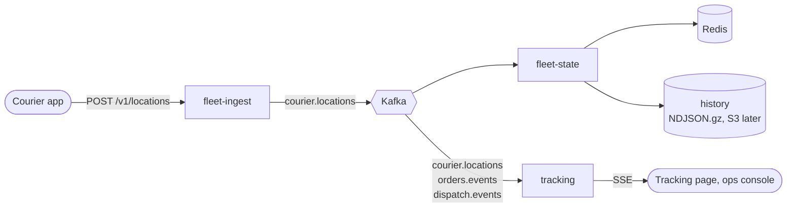

# fleet

The location path of Tasuki ([docs/design.md](../../docs/design.md) §5, §7.2, §9, §10): courier GPS points come in,
the live fleet is kept in Redis for dispatch, and customers and the ops console watch couriers move. One Go module,
three binaries, one Dockerfile.



| Binary | Design | Does | Reads | Writes |
|---|---|---|---|---|
| `fleet-ingest` | §7.2 step 2 | Courier-authenticated batches of 1–50 GPS points; validates, stamps `received_at`, publishes | HTTP | `courier.locations` (key `courier_id`) |
| `fleet-state` | §7.2 steps 3, 5 | Newest point per courier in Redis (atomic, latest wins), geo sets, sweeper, rebuild from the log, history | `courier.locations` (group `fleet-state`) | Redis, history files |
| `tracking` | §7.2 step 4 | Server-sent events for one order or the whole fleet | `courier.locations`, `orders.events`, `dispatch.events` (no group: every replica reads everything) | HTTP streams |

Event and HTTP shapes are the ones in [contracts/README.md](../../contracts/README.md); the Go types live in
`internal/events` and the tests validate them against [contracts/events](../../contracts/events).

## How each piece behaves

**fleet-ingest.** `POST /v1/locations` with `Authorization: Bearer <courier JWT>` and
`{"points": [{"lat", "lng", "accuracy_m", "speed_mps", "heading_deg", "device_time", "status", "order_id"}]}`.

- The courier ID comes from the token, never from the body.
- Points are checked one at a time: a malformed point, a `device_time` more than 30 s in the future, or a repeated
  `device_time` is dropped and counted; the rest go through. `202 {"accepted": n, "dropped": n}`.
- There are no speed or "teleport" checks: the simulator runs the clock faster than real time.
- 401 for a missing, invalid, expired or non-courier token; 400 for invalid JSON; 413 above 64 KiB; 422 for 0 or
  more than 50 points, or when every point is invalid.
- **Load shedding.** The producer buffer is bounded and records are added with `TryProduce`, which never blocks. If
  the buffer is full, or Kafka has not acknowledged the batch within 2 s, the answer is `503` + `Retry-After: 5`.
  The courier app drops the batch and sends a fresher one later: this path is allowed to lose points.
- Readiness does **not** depend on Kafka. If every replica went unready during a Kafka outage, the load balancer
  would refuse connections instead of returning a 503 that tells clients when to come back.

**fleet-state.** Consumes `courier.locations` in the `fleet-state` group, commits only after Redis has the batch
(at-least-once), and keeps the [contract's Redis keys](../../contracts/README.md#redis-keys-fleet-state-writes-dispatch-and-tracking-read):

| Key | What fleet-state does |
|---|---|
| `courier:{id}` (hash, TTL `COURIER_TTL`) | One Lua script compares `device_time` and writes only if the point is newer, so late or duplicated messages are harmless |
| `geo:couriers:all`, `geo:couriers:available` | `GEOADD` in the same script; `available` only while `idle`; `offline` removes the courier |
| `couriers:last_seen` (sorted set, addition) | `received_at` per courier; the sweeper removes couriers quiet for `SEEN_WINDOW` from both geo sets, atomically |
| `fleet:state:rebuilt_at` (string, addition) | Set after a rebuild. If it disappears, Redis lost its data, and fleet-state rebuilds again |

- **Redis is a cache derived from the log.** On start, fleet-state replays the last `REBUILD_WINDOW` of the topic
  (by record timestamp = `received_at`) into Redis before it reports ready. The sweeper checks the marker every
  `SWEEP_INTERVAL`, so an emptied Redis (restart without persistence, failover, `FLUSHALL`) is refilled in seconds.
- When Redis is down, the consumer retries the same batch with backoff and does not commit. Lag grows, the freshness
  SLI burns, and nothing is lost.
- **History** sits behind the `history.Sink` interface. P1 writes gzipped NDJSON under
  `HISTORY_DIR/locations/dt=YYYY-MM-DD/hour=HH/part-<ULID>.ndjson.gz` (UTC, by `received_at`). This is the same
  layout the S3/Parquet sink will use. Files appear under their final name only when complete, and roll every
  `HISTORY_ROLL_INTERVAL`. History is best effort, lowest priority (§10): a failing disk is counted and logged but
  never blocks Redis.

**tracking.** Reads Kafka directly, never Redis, so a Redis outage cannot stop tracking (§7.2, §10).

- `GET /v1/track/{token}/stream`: `{token}` is the tracking JWT (`role=tracking`, `sub` = order ID).
  - Sends `status`, then the courier's `position` events, then `end` with reason `delivered`, `cancelled`,
    `failed` or `expired`, and closes.
  - 401 for a bad or expired token. 404 when the order is still unknown after `TRACKING_UNKNOWN_ORDER_WAIT`: a
    customer can open the link before `OrderConfirmed` reaches this replica.
  - `status.eta` is the delivery time promised at confirmation (RFC 3339), or `null` until an order event has
    been seen.
- `GET /v1/fleet/stream?ward=` sends `courier` (with `ward` = nearest ward centre, `null` outside the 23 wards) and
  `courier_gone`, sent when a courier has not been seen for `SEEN_WINDOW`. Viewers filtered on a ward also get
  `courier_gone` when a courier moves out of it.
  - Access: `FLEET_STREAM_TOKEN` (Bearer header, or `?token=` because `EventSource` cannot set headers), or
    `FLEET_STREAM_PUBLIC=true` for local runs. With neither set, the stream returns 403.
- Both streams start with the current state: every courier in scope, or the order's `status` and last `position`.
  Their headers are `Cache-Control: no-cache` and `X-Accel-Buffering: no`. `TRACKING_CORS_ORIGINS` applies to the
  stream endpoints only. Access logs record the route pattern (`GET /v1/track/{token}/stream`), never the path, so
  tracking tokens are not logged.
- The order → courier map is rebuilt at start by replaying `orders.events` and `dispatch.events` from the earliest
  retained offset. The replica is unready until it reaches the end offsets it saw at start. Status only moves
  forward (confirmed → assigned → picked_up → finished), so the arrival order across the two topics does not
  matter. A newer `CourierAssigned` wins (reassignment).
- **Slow viewers never block the consumer.** Each stream has a bounded queue. When a viewer reads too slowly, the
  oldest queued event is dropped and counted. Each write also has its own deadline, so a client that stops reading
  is disconnected.
- `: ping` every 15 s. On shutdown, open streams are closed so `EventSource` reconnects to another replica.
- **Brownout knob:** `TRACKING_MIN_INTERVAL` (e.g. `10s` during a rain surge, §10) sends at most one position per
  courier per viewer per interval.

## Configuration

Environment variables only. Durations use Go syntax (`500ms`, `5s`, `2m`). Every service also reads `PORT` (8080),
`LOG_LEVEL` (info), `SHUTDOWN_TIMEOUT` (20s; set `terminationGracePeriodSeconds` ≥ 25) and `KAFKA_BROKERS`
(`localhost:9092`, comma separated).

| Variable | Service | Default | Meaning |
|---|---|---|---|
| `COURIER_TOKEN_SECRET` | fleet-ingest | required | HS256 secret shared with orders, ≥ 32 bytes |
| `KAFKA_TOPIC_LOCATIONS` | all | `courier.locations` | |
| `INGEST_MAX_POINTS` | fleet-ingest | `50` | Points per batch |
| `INGEST_MAX_BODY_BYTES` | fleet-ingest | `65536` | Larger bodies get 413 |
| `INGEST_MAX_FUTURE_SKEW` | fleet-ingest | `30s` | Drop points whose `device_time` is further ahead |
| `INGEST_PUBLISH_TIMEOUT` | fleet-ingest | `2s` | Wait this long for Kafka, then 503 |
| `INGEST_RETRY_AFTER` | fleet-ingest | `5s` | `Retry-After` on 503 |
| `INGEST_MAX_BUFFERED_RECORDS` | fleet-ingest | `10000` | Producer buffer; full means shed |
| `REDIS_URL` | fleet-state | `redis://localhost:6379/0` | `rediss://` for TLS |
| `KAFKA_GROUP` | fleet-state | `fleet-state` | Consumer group (replicas share partitions) |
| `COURIER_TTL` | fleet-state | `10m` | TTL of `courier:{id}` |
| `SEEN_WINDOW` | fleet-state, tracking | `60s` | Quiet couriers leave the geo sets / get `courier_gone` |
| `SWEEP_INTERVAL` | fleet-state | `5s` | Sweeper and Redis-loss check |
| `REBUILD_WINDOW` | fleet-state | `5m` | Log replayed into Redis at start and after Redis loss; `0` = none |
| `HISTORY_DIR` | fleet-state | empty (off) | Local history root; needs a writable volume |
| `HISTORY_ROLL_INTERVAL` | fleet-state | `5m` | Close history files this often (bounds loss on a crash) |
| `TRACKING_TOKEN_SECRET` | tracking | required | HS256 secret shared with orders, ≥ 32 bytes |
| `KAFKA_TOPIC_ORDERS`, `KAFKA_TOPIC_DISPATCH` | tracking | `orders.events`, `dispatch.events` | |
| `TRACKING_LOCATION_LOOKBACK` | tracking | `1m` | Positions loaded at start |
| `TRACKING_HEARTBEAT` | tracking | `15s` | `: ping` interval |
| `TRACKING_MIN_INTERVAL` | tracking | `0` (off) | Brownout: minimum time between positions per courier per viewer |
| `TRACKING_VIEWER_BUFFER` | tracking | `64` | Queued events per stream before dropping the oldest |
| `TRACKING_MAX_VIEWERS` | tracking | `5000` | Streams per replica; then 503 + `Retry-After` |
| `TRACKING_WRITE_TIMEOUT` | tracking | `10s` | Disconnect a client that stops reading |
| `TRACKING_UNKNOWN_ORDER_WAIT` | tracking | `3s` | Grace before 404 for a brand-new order |
| `ORDER_STATE_TTL` | tracking | `48h` | Forget orders with no event for this long |
| `FLEET_STREAM_TOKEN` | tracking | empty | Shared token for `/v1/fleet/stream` |
| `FLEET_STREAM_PUBLIC` | tracking | `false` | Allow `/v1/fleet/stream` without a token (local only) |
| `TRACKING_CORS_ORIGINS` | tracking | empty | Browser origins allowed to open streams (comma separated, or `*`) |

## Metrics and SLIs

Each service serves `/metrics` on its main port: `http_requests_total` and `http_request_duration_seconds` by
route, Go runtime metrics, and the following.

| Metric | SLI / use |
|---|---|
| `fleet_state_freshness_seconds` (histogram) | **Location freshness** (§9): share of points in Redis within 2 s of receipt = `le="2"` / count. Live points only; rebuilds are excluded |
| `tracking_event_age_seconds{stream}` (histogram) | **Tracking freshness** (§9): share of position events younger than 10 s at the viewer = `le="10"` / count. Live events only; snapshots are excluded |
| `tracking_sse_connections{stream}` | Open streams |
| `tracking_sse_dropped_events_total{stream}`, `tracking_sse_throttled_events_total{stream}` | Slow viewers, brownout |
| `fleet_ingest_points_total{result}` | `accepted`, `invalid`, `future`, `duplicate`, `shed` |
| `fleet_ingest_shed_requests_total{reason}` | `buffer_full`, `timeout`, `kafka_error` |
| `fleet_state_points_total{result}`, `fleet_state_swept_couriers_total`, `fleet_state_rebuilds_total`, `fleet_state_last_rebuild_duration_seconds`, `fleet_state_history_errors_total` | fleet-state internals |
| `tracking_couriers`, `tracking_orders`, `tracking_records_invalid_total{topic}` | tracking internals |

## Develop

```bash
make fleet-lint    # gofmt, go vet, golangci-lint (same config as services/api-go)
make fleet-test    # go test -race -cover ./... — no Docker: Kafka is kfake, Redis is miniredis
make fleet-build   # binaries in services/fleet/bin/
make fleet-images  # fleet-ingest:local, fleet-state:local, tracking:local

# One image per binary:
docker build --build-arg SERVICE=tracking -t tracking:local services/fleet
```

Run against a local Kafka and Redis, for example:

```bash
cd services/fleet
COURIER_TOKEN_SECRET=$(openssl rand -hex 32) PORT=8081 go run ./cmd/fleet-ingest
REDIS_URL=redis://localhost:6379/0 PORT=8084 go run ./cmd/fleet-state
TRACKING_TOKEN_SECRET=... FLEET_STREAM_PUBLIC=true PORT=8083 go run ./cmd/tracking
```

`go generate ./...` refreshes `internal/wards/wards.json` from `contracts/data/wards.json`. A test fails if the
two differ.

## Code layout

| Package | Holds | Reused by `dispatch` (later) |
|---|---|---|
| `internal/kit` | Env config, JSON logs, HTTP server (probes, metrics, request IDs), shutdown order, Kafka consume loop, `Retry`, `CatchUp` (replay progress) | yes |
| `internal/events` | Event types matching `contracts/events`, prefixed ULIDs | yes |
| `internal/auth` | HS256 courier and tracking token verification | yes |
| `internal/wards` | The 23 wards (embedded) and nearest-ward lookup | yes |
| `internal/ingest`, `internal/state`, `internal/history`, `internal/tracking` | One service each; `Run` wires it from the environment | |
| `cmd/<service>` | `main`: signals, logger, `healthcheck` subcommand | |

Shutdown, in every binary, on SIGTERM:
1. Fail `/readyz` and end open streams.
2. Drain in-flight HTTP requests.
3. Stop the workers (consumers, sweepers).
4. Run the stop steps in reverse order: flush the producer, leave the consumer group, close history files, close
   Redis.
5. Exit 0 within `SHUTDOWN_TIMEOUT`.

## Not built yet

- History to S3 as hourly Parquet (the `history.Sink` seam is ready), and history as its own consumer group that
  commits only after an upload.
- H3 cells (P3, batched dispatch); P1 uses Redis GEO.
- Kafka TLS/SASL settings and OpenTelemetry traces.
- Redis Cluster: the Lua scripts touch several keys, so Redis must run as a primary with replicas (no cluster mode).
