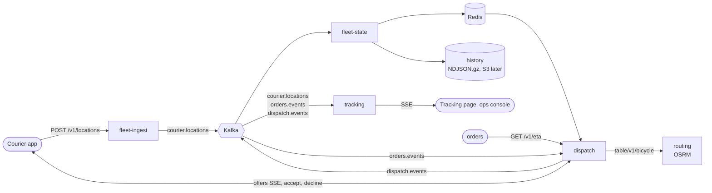

# fleet

The location path of Tasuki ([docs/design.md](../../docs/design.md) §5, §7.2, §9, §10): courier GPS points come in,
the live fleet is kept in Redis for dispatch, and customers and the ops console watch couriers move, and dispatch hands each order to a courier (§7.3). One Go
module, four binaries, one Dockerfile.



| Binary | Design | Does | Reads | Writes |
|---|---|---|---|---|
| `fleet-ingest` | §7.2 step 2 | Courier-authenticated batches of 1–50 GPS points; validates, stamps `received_at`, publishes | HTTP | `courier.locations` (key `courier_id`) |
| `fleet-state` | §7.2 steps 3, 5 | Newest point per courier in Redis (atomic, latest wins), geo sets, sweeper, rebuild from the log, history | `courier.locations` (group `fleet-state`) | Redis, history files |
| `tracking` | §7.2 step 4 | Server-sent events for one order or the whole fleet | `courier.locations`, `orders.events`, `dispatch.events` (no group: every replica reads everything) | HTTP streams |
| `dispatch` | §7.3 (P1 greedy) | Offers each order to the nearest free courier by road time; courier offer stream, accept/decline; ETAs for quotes | `orders.events` (group `dispatch`), Redis geo sets, OSRM | `dispatch.events` (key `order_id`), Redis (`dispatch:*`) |

Event and HTTP shapes are the ones in [contracts/README.md](../../contracts/README.md); the Go types live in
`internal/events` and the tests validate them against [contracts/events](../../contracts/events).

## How each piece behaves

**fleet-ingest.** `POST /v1/locations` with `Authorization: Bearer <courier JWT>` and
`{"points": [{"lat", "lng", "accuracy_m", "speed_mps", "heading_deg", "device_time", "status", "order_id"}]}`.

- The courier ID comes from the token, never from the body.
- Points are checked one at a time: a malformed point, a `device_time` more than 30 s in the future, or a repeated
  `device_time` is dropped and counted; the rest go through. `202 {"accepted": n, "dropped": n}`.
- There are no speed or "teleport" checks: the simulator runs the clock faster than real time.
- 401 for a missing, invalid, expired or non-courier token; 400 for invalid JSON; 413 above 64 KiB; 422 for 0 or
  more than 50 points, or when every point is invalid.
- **Load shedding.** The producer buffer is bounded and records are added with `TryProduce`, which never blocks. If
  the buffer is full, or Kafka has not acknowledged the batch within 2 s, the answer is `503` + `Retry-After: 5`.
  The courier app drops the batch and sends a fresher one later: this path is allowed to lose points.
- Readiness does **not** depend on Kafka. If every replica went unready during a Kafka outage, the load balancer
  would refuse connections instead of returning a 503 that tells clients when to come back.

**fleet-state.** Consumes `courier.locations` in the `fleet-state` group, commits only after Redis has the batch
(at-least-once), and keeps the [contract's Redis keys](../../contracts/README.md#redis-keys-fleet-state-writes-dispatch-and-tracking-read):

| Key | What fleet-state does |
|---|---|
| `courier:{id}` (hash, TTL `COURIER_TTL`) | One Lua script compares `device_time` and writes only if the point is newer, so late or duplicated messages are harmless |
| `geo:couriers:all`, `geo:couriers:available` | `GEOADD` in the same script; `available` only while `idle`; `offline` removes the courier |
| `couriers:last_seen` (sorted set, addition) | `received_at` per courier; the sweeper removes couriers quiet for `SEEN_WINDOW` from both geo sets, atomically |
| `fleet:state:rebuilt_at` (string, addition) | Set after a rebuild. If it disappears, Redis lost its data, and fleet-state rebuilds again |
| `fleet:state:rebuilding:<token>` (string, addition) | One per rebuild in flight (1 h TTL). If Redis loses its data mid-rebuild this key goes too, so the rebuild starts over instead of marking a half-empty Redis as rebuilt; `rebuilt_at` never moves backwards |

- **Redis is a cache derived from the log.** On start, fleet-state replays the last `REBUILD_WINDOW` of the topic
  (by record timestamp = `received_at`) into Redis before it reports ready. The sweeper checks the marker every
  `SWEEP_INTERVAL`, so an emptied Redis (restart without persistence, failover, `FLUSHALL`) is refilled in seconds.
- When Redis is down, the consumer retries the same batch with backoff and does not commit. Lag grows, the freshness
  SLI burns, and nothing is lost.
- **History** sits behind the `history.Sink` interface. P1 writes gzipped NDJSON under
  `HISTORY_DIR/locations/dt=YYYY-MM-DD/hour=HH/part-<ULID>.ndjson.gz` (UTC, by `received_at`). This is the same
  layout the S3/Parquet sink will use. Files appear under their final name only when complete, and roll every
  `HISTORY_ROLL_INTERVAL`. History is best effort, lowest priority (§10): a failing disk is counted and logged but
  never blocks Redis.

**tracking.** Reads Kafka directly, never Redis, so a Redis outage cannot stop tracking (§7.2, §10).

- `GET /v1/track/{token}/stream`: `{token}` is the tracking JWT (`role=tracking`, `sub` = order ID).
  - Sends `status`, then the courier's `position` events, then `end` with reason `delivered`, `cancelled`,
    `failed` or `expired`, and closes.
  - 401 for a bad or expired token. 404 when the order is still unknown after `TRACKING_UNKNOWN_ORDER_WAIT`: a
    customer can open the link before `OrderConfirmed` reaches this replica.
  - `status.eta` is the delivery time promised at confirmation (RFC 3339), or `null` until an order event has
    been seen.
- `GET /v1/fleet/stream?ward=` sends `courier` (with `ward` = nearest ward centre, `null` outside the 23 wards) and
  `courier_gone`, sent when a courier has not been seen for `SEEN_WINDOW`. Viewers filtered on a ward also get
  `courier_gone` when a courier moves out of it.
  - Access: `FLEET_STREAM_TOKEN` (Bearer header, or `?token=` because `EventSource` cannot set headers), or
    `FLEET_STREAM_PUBLIC=true` for local runs. With neither set, the stream returns 403.
- Both streams start with the current state: every courier in scope, or the order's `status` and last `position`.
  Their headers are `Cache-Control: no-cache` and `X-Accel-Buffering: no`. `TRACKING_CORS_ORIGINS` applies to the
  stream endpoints only. Access logs record the route pattern (`GET /v1/track/{token}/stream`), never the path, so
  tracking tokens are not logged.
- The order → courier map is rebuilt at start by replaying `orders.events` and `dispatch.events` from the earliest
  retained offset. The replica is unready until it reaches the end offsets it saw at start. Status only moves
  forward (confirmed → assigned → picked_up → finished), so the arrival order across the two topics does not
  matter. A newer `CourierAssigned` wins (reassignment).
- **Slow viewers never block the consumer.** Each stream has a bounded queue. When a viewer reads too slowly, the
  oldest queued event is dropped and counted. Each write also has its own deadline, so a client that stops reading
  is disconnected.
- `: ping` every 15 s. On shutdown, open streams are closed so `EventSource` reconnects to another replica.
- **Brownout knob:** `TRACKING_MIN_INTERVAL` (e.g. `10s` during a rain surge, §10) sends at most one position per
  courier per viewer per interval.

**dispatch.** Greedy matching (design §7.3, P1); batched matching and ward leases come in P3.

- **Ownership.** Replicas share `orders.events` through the consumer group `dispatch`. The topic is keyed by
  `order_id`, so the owner of a partition sees all of an order's events, and its matcher is the one that offers
  the order. Offsets are committed only after Redis has the batch (at-least-once), and every event is applied by
  one Lua script that also records its `event_id` (dedupe).
- **State lives in Redis, not in the process** (`dispatch:*` keys below). Any replica can answer any courier, and
  a replica that dies loses nothing: its partitions move, and the new owner reads the same pending sets.
- **Correct with several replicas.** Every change is one atomic Lua script on the Redis primary. An order can only
  be offered while it is `pending`; a courier is reserved with `SET NX PX OFFER_TTL`, so two replicas can never
  hold an offer for the same courier, and the reservation frees itself when the offer expires; an answer only
  counts while its offer is `open` and unexpired. Partition ownership only shares the work: two replicas that
  briefly own the same partition during a rebalance still cannot double-offer (tested with two matchers on one
  Redis).
- **Matching.** Every `MATCH_INTERVAL` (and at once when an order arrives), oldest order first: `GEOSEARCH` on
  `geo:couriers:available` around the store, starting at `SEARCH_RADIUS_M` and doubling up to
  `SEARCH_MAX_RADIUS_M` until there are 3 free couriers. Couriers with an open offer, an active order, or who
  already declined (or let expire) this order are skipped. Up to `SEARCH_MAX_CANDIDATES` are ranked by one OSRM
  `table/v1/bicycle` call per attempt, which also gives the store-to-drop-off time.
- **OSRM fallback.** When `ROUTING_URL=none`, or OSRM fails or exceeds `ROUTING_TIMEOUT`, road times are the
  straight-line distance × 1.35 at 15 km/h (the same estimate orders uses), counted in
  `dispatch_eta_requests_total{source="fallback"}`. After 3 failures in a row OSRM is skipped for 10 s (a small
  circuit breaker), so a slow OSRM cannot add its timeout to every match.
- **Offers.** An offer lasts `OFFER_TTL`. Accept → `OfferAccepted` + `CourierAssigned` (with `eta_pickup_s` and
  `eta_dropoff_s`); the courier stays busy until `OrderDelivered`, `OrderFailed` or `OrderCancelled`. Decline or
  expiry → `OfferDeclined` / `OfferExpired`, and the order goes to the next courier at once. `OrderCancelled`
  withdraws an open offer (`offer_cancelled`, reason `order_cancelled`) and frees the courier.
- **No courier.** After `MAX_OFFER_ATTEMPTS` offers, or when no offer could be made `NO_COURIER_AFTER` after
  confirmation, dispatch emits `NoCourierAvailable`, then repeats it at most every `NO_COURIER_REPORT_INTERVAL`
  while it keeps searching every `RETRY_INTERVAL` (couriers come online). orders cancels the order once it is
  15 minutes old.
- **Outbox.** Each script that changes state writes its `dispatch.events` to a Redis outbox in the same atomic
  step. The event is produced at once and removed when Kafka acknowledges it; anything still there after
  `OUTBOX_LEASE` (Kafka down, replica crashed) is sent again by a relay on every replica, with the same `event_id`.
- **Courier stream.** `GET /v1/couriers/me/offers/stream` (courier JWT) sends `offer` and `offer_cancelled`
  exactly as in the contract, the current open offer on connect, and `: ping` every `OFFER_HEARTBEAT`, with
  `X-Accel-Buffering: no`. The offer is made on the order's owner but the stream may be on another replica, so
  messages travel on one Redis pub/sub channel (`dispatch:offers`) that every replica subscribes to once: one
  Redis connection per replica instead of one per courier. Pub/sub is best effort, so every heartbeat also re-reads
  the courier's open offer from Redis and sends it if the stream has not seen it.
- **ETA.** `GET /v1/eta` answers within `ETA_BUDGET` (orders gives up at 300 ms): the nearest free couriers within
  `SEARCH_MAX_RADIUS_M`, one OSRM call capped at `ETA_ROUTING_TIMEOUT`, then the fallback. `pickup_s` is the
  nearest courier's road time to the store (with nobody nearby: the ride in from the maximum radius), `travel_s` the
  store to the drop-off, `supply` is `none`, `low` (fewer than `SUPPLY_LOW_BELOW` free couriers) or `ok`. 503 when
  Redis is unavailable, so orders falls back.
- **SLI.** `dispatch_assignment_duration_seconds{outcome}` is observed once per order, from
  `OrderConfirmed.occurred_at`: at `CourierAssigned` (`assigned`) or at the first `NoCourierAvailable`
  (`no_courier`), so orders that never get a courier count as bad. Whoever sets the order's `sli` flag first (one
  `HSETNX` inside the script) observes it.
- **Redis loss and first start.** dispatch keeps a sentinel key. When it disappears (Redis restarted empty or failed
  over), dispatch pauses matching and fails readiness, waits for `fleet:state:rebuilt_at` to be at or after the
  last time it saw the sentinel (so the geo sets are full again), replays the last `RECOVERY_WINDOW` of
  `orders.events` and `dispatch.events` into Redis, sets the sentinel and resumes. Limits: orders confirmed before
  the window are not restored (orders cancels unassigned ones at 15 minutes anyway); open offers are lost and
  offered afresh (a courier who answers one gets 404); events still in the outbox at the moment of the loss are lost.
- **Shutdown.** On SIGTERM the consumer and the matcher stop at once (no new orders, no new offers), streams end so
  couriers reconnect to another replica, HTTP drains, the producer flushes, and the replica leaves the group so its
  partitions move immediately. It holds no reservations of its own to release: each one belongs to an offer in
  Redis, which any replica can answer and the new owner expires (or `PX` frees).

| Redis key (dispatch) | Type | Content |
|---|---|---|
| `dispatch:order:{order_id}` | hash | Status (`pending`, `offered`, `assigned`, `picked_up`, `done`), ward, partition, store, drop-off, attempts, current offer and courier, SLI flag; TTL `ORDER_STATE_TTL` |
| `dispatch:pending:{partition}` | set | Orders of that `orders.events` partition still waiting for a courier |
| `dispatch:offer:{offer_id}` | hash | Order, courier, status (`open`, `accepted`, `declined`, `expired`, `withdrawn`), expiry, ETAs, SSE payload; kept `OFFER_TTL` + 10 min |
| `dispatch:reserved:{courier_id}` | string | The courier's open offer: `SET NX PX OFFER_TTL` |
| `dispatch:busy:{courier_id}` | string | The order the courier carries, accept to delivery; TTL `COURIER_BUSY_TTL` as a safety net |
| `dispatch:tried:{order_id}` | set | Couriers who declined the order or let an offer expire |
| `dispatch:event:{event_id}` | string | Consumed event IDs (dedupe), TTL `ORDER_STATE_TTL` |
| `dispatch:outbox`, `dispatch:outbox:events` | sorted set, hash | Events waiting for a Kafka acknowledgement, by resend time |
| `dispatch:sentinel` | string | Present while Redis holds dispatch's state |
| `dispatch:offers` | pub/sub channel | Messages for courier offer streams, read by every replica |

## Configuration

Environment variables only. Durations use Go syntax (`500ms`, `5s`, `2m`). Every service also reads `PORT` (8080),
`LOG_LEVEL` (info), `SHUTDOWN_TIMEOUT` (20s; set `terminationGracePeriodSeconds` ≥ 25) and `KAFKA_BROKERS`
(`localhost:9092`, comma separated).

| Variable | Service | Default | Meaning |
|---|---|---|---|
| `COURIER_TOKEN_SECRET` | fleet-ingest | required | HS256 secret shared with orders, ≥ 32 bytes |
| `KAFKA_TOPIC_LOCATIONS` | all | `courier.locations` | |
| `INGEST_MAX_POINTS` | fleet-ingest | `50` | Points per batch |
| `INGEST_MAX_BODY_BYTES` | fleet-ingest | `65536` | Larger bodies get 413 |
| `INGEST_MAX_FUTURE_SKEW` | fleet-ingest | `30s` | Drop points whose `device_time` is further ahead |
| `INGEST_PUBLISH_TIMEOUT` | fleet-ingest | `2s` | Wait this long for Kafka, then 503 |
| `INGEST_RETRY_AFTER` | fleet-ingest | `5s` | `Retry-After` on 503 |
| `INGEST_MAX_BUFFERED_RECORDS` | fleet-ingest | `10000` | Producer buffer; full means shed |
| `REDIS_URL` | fleet-state | `redis://localhost:6379/0` | `rediss://` for TLS |
| `KAFKA_GROUP` | fleet-state | `fleet-state` | Consumer group (replicas share partitions) |
| `COURIER_TTL` | fleet-state | `10m` | TTL of `courier:{id}` |
| `SEEN_WINDOW` | fleet-state, tracking | `60s` | Quiet couriers leave the geo sets / get `courier_gone` |
| `SWEEP_INTERVAL` | fleet-state | `5s` | Sweeper and Redis-loss check |
| `REBUILD_WINDOW` | fleet-state | `5m` | Log replayed into Redis at start and after Redis loss; `0` = none |
| `HISTORY_DIR` | fleet-state | empty (off) | Local history root; needs a writable volume |
| `HISTORY_ROLL_INTERVAL` | fleet-state | `5m` | Close history files this often (bounds loss on a crash) |
| `TRACKING_TOKEN_SECRET` | tracking | required | HS256 secret shared with orders, ≥ 32 bytes |
| `KAFKA_TOPIC_ORDERS`, `KAFKA_TOPIC_DISPATCH` | tracking | `orders.events`, `dispatch.events` | |
| `TRACKING_LOCATION_LOOKBACK` | tracking | `1m` | Positions loaded at start |
| `TRACKING_HEARTBEAT` | tracking | `15s` | `: ping` interval |
| `TRACKING_MIN_INTERVAL` | tracking | `0` (off) | Brownout: minimum time between positions per courier per viewer |
| `TRACKING_VIEWER_BUFFER` | tracking | `64` | Queued events per stream before dropping the oldest |
| `TRACKING_MAX_VIEWERS` | tracking | `5000` | Streams per replica; then 503 + `Retry-After` |
| `TRACKING_WRITE_TIMEOUT` | tracking | `10s` | Disconnect a client that stops reading |
| `TRACKING_UNKNOWN_ORDER_WAIT` | tracking | `3s` | Grace before 404 for a brand-new order |
| `ORDER_STATE_TTL` | tracking | `48h` | Forget orders with no event for this long |
| `FLEET_STREAM_TOKEN` | tracking | empty | Shared token for `/v1/fleet/stream` |
| `FLEET_STREAM_PUBLIC` | tracking | `false` | Allow `/v1/fleet/stream` without a token (local only) |
| `TRACKING_CORS_ORIGINS` | tracking | empty | Browser origins allowed to open streams (comma separated, or `*`) |
| `HTTP_PORT` | dispatch | `8080` | Listen port (falls back to `PORT`, which the other binaries use) |
| `COURIER_TOKEN_SECRET` | dispatch | required | HS256 secret shared with orders, ≥ 32 bytes |
| `REDIS_URL` | dispatch | `redis://localhost:6379/0` | The same Redis as fleet-state |
| `KAFKA_GROUP` | dispatch | `dispatch` | Consumer group on `orders.events` |
| `KAFKA_TOPIC_ORDERS`, `KAFKA_TOPIC_DISPATCH` | dispatch | `orders.events`, `dispatch.events` | |
| `ROUTING_URL` | dispatch | required | OSRM base URL, e.g. `http://routing:5000`; `none` = always the straight-line estimate |
| `ROUTING_TIMEOUT` | dispatch | `1s` | OSRM budget per matching attempt |
| `OFFER_TTL` | dispatch | `30s` | How long a courier has to answer; also the reservation's `PX` |
| `MAX_OFFER_ATTEMPTS` | dispatch | `3` | Offers before `NoCourierAvailable` is reported (offering continues) |
| `SEARCH_RADIUS_M`, `SEARCH_MAX_RADIUS_M` | dispatch | `1500`, `6000` | First search radius around the store; doubled up to the maximum |
| `SEARCH_MAX_CANDIDATES` | dispatch | `10` | Couriers ranked by road time per attempt |
| `NO_COURIER_AFTER` | dispatch | `60s` | Report `NoCourierAvailable` when no offer could be made this long after confirmation |
| `NO_COURIER_REPORT_INTERVAL` | dispatch | `60s` | Repeat `NoCourierAvailable` at most this often while the order waits |
| `RETRY_INTERVAL` | dispatch | `5s` | Wait between attempts that found nobody |
| `MATCH_INTERVAL` | dispatch | `1s` | Matching pass interval (new orders are matched at once) |
| `OFFER_HEARTBEAT` | dispatch | `15s` | `: ping` and open-offer re-read on courier streams |
| `OFFER_WRITE_TIMEOUT` | dispatch | `10s` | Disconnect a courier stream that stops reading |
| `OFFER_MAX_STREAMS` | dispatch | `5000` | Courier streams per replica; then 503 + `Retry-After` |
| `ETA_BUDGET`, `ETA_ROUTING_TIMEOUT` | dispatch | `250ms`, `150ms` | Whole `GET /v1/eta`, and OSRM's share of it |
| `SUPPLY_LOW_BELOW` | dispatch | `3` | Fewer free couriers than this within the maximum radius is `supply: "low"` |
| `RECOVERY_WINDOW` | dispatch | `30m` | History replayed into Redis on a first start or after a Redis loss; also where a new consumer group starts |
| `ORDER_STATE_TTL` | dispatch | `24h` | Lifetime of order records and dedupe keys |
| `COURIER_BUSY_TTL` | dispatch | `3h` | Safety net: a courier is freed even if the delivery event never arrives |
| `OUTBOX_LEASE` | dispatch | `10s` | Resend an event Kafka has not acknowledged after this |

## Metrics and SLIs

Each service serves `/metrics` on its main port: `http_requests_total` and `http_request_duration_seconds` by
route, Go runtime metrics, and the following.

| Metric | SLI / use |
|---|---|
| `fleet_state_freshness_seconds` (histogram) | **Location freshness** (§9): share of points in Redis within 2 s of receipt = `le="2"` / count. Live points only; rebuilds are excluded |
| `tracking_event_age_seconds{stream}` (histogram) | **Tracking freshness** (§9): share of position events younger than 10 s at the viewer = `le="10"` / count. Live events only; snapshots are excluded |
| `tracking_sse_connections{stream}` | Open streams |
| `tracking_sse_dropped_events_total{stream}`, `tracking_sse_throttled_events_total{stream}` | Slow viewers, brownout |
| `fleet_ingest_points_total{result}` | `accepted`, `invalid`, `future`, `duplicate`, `shed` |
| `fleet_ingest_shed_requests_total{reason}` | `buffer_full`, `timeout`, `kafka_error` |
| `fleet_state_points_total{result}`, `fleet_state_swept_couriers_total`, `fleet_state_rebuilds_total`, `fleet_state_last_rebuild_duration_seconds`, `fleet_state_history_errors_total` | fleet-state internals |
| `tracking_couriers`, `tracking_orders`, `tracking_records_invalid_total{topic}` | tracking internals |
| `dispatch_assignment_duration_seconds{outcome}` (histogram) | **Dispatch speed** (§9): good = `outcome="assigned"`, `le="60"`; total = all outcomes. Once per order, `assigned` or `no_courier` |
| `dispatch_eta_requests_total{source}` | `osrm` or `fallback` road times (ETAFallbackHigh, `component="dispatch"`) |
| `dispatch_offers_total{outcome}` | `sent`, `accepted`, `declined`, `expired`, `withdrawn` |
| `dispatch_pending_orders{ward}` | Orders without a courier owned by this replica (sum over replicas) |
| `dispatch_couriers{state}`, `dispatch_outbox_events` | `available` / `online` couriers and outbox size, global values (use `max()`) |
| `dispatch_offer_streams`, `dispatch_paused`, `dispatch_recoveries_total`, `dispatch_order_events_total{type,result}`, `dispatch_records_invalid_total{topic}`, `dispatch_publish_failures_total` | dispatch internals |

## Develop

```bash
make fleet-lint    # gofmt, go vet, golangci-lint (same config as services/api-go)
make fleet-test    # go test -race -cover ./... — no Docker: Kafka is kfake, Redis is miniredis
make fleet-build   # binaries in services/fleet/bin/
make fleet-images  # fleet-ingest:local, fleet-state:local, tracking:local, dispatch:local

# One image per binary:
docker build --build-arg SERVICE=tracking -t tracking:local services/fleet
```

Run against a local Kafka and Redis, for example:

```bash
cd services/fleet
COURIER_TOKEN_SECRET=$(openssl rand -hex 32) PORT=8081 go run ./cmd/fleet-ingest
REDIS_URL=redis://localhost:6379/0 PORT=8084 go run ./cmd/fleet-state
TRACKING_TOKEN_SECRET=... FLEET_STREAM_PUBLIC=true PORT=8083 go run ./cmd/tracking
COURIER_TOKEN_SECRET=... ROUTING_URL=http://localhost:5000 HTTP_PORT=8082 go run ./cmd/dispatch
```

`go generate ./...` refreshes `internal/wards/wards.json` from `contracts/data/wards.json`. A test fails if the
two differ.

## Code layout

| Package | Holds | Reused by `dispatch` |
|---|---|---|
| `internal/kit` | Env config, JSON logs, HTTP server (probes, metrics, request IDs), shutdown order, Kafka consume loop, `Retry`, `CatchUp` (replay progress) | yes |
| `internal/events` | Event types matching `contracts/events`, prefixed ULIDs | yes |
| `internal/auth` | HS256 courier and tracking token verification | yes |
| `internal/wards` | The 23 wards (embedded) and nearest-ward lookup | yes |
| `internal/ingest`, `internal/state`, `internal/history`, `internal/tracking`, `internal/dispatch` | One service each; `Run` wires it from the environment | `state`: Redis key names |
| `cmd/<service>` | `main`: signals, logger, `healthcheck` subcommand | |

Shutdown, in every binary, on SIGTERM:
1. Fail `/readyz` and end open streams.
2. Drain in-flight HTTP requests.
3. Stop the workers (consumers, sweepers).
4. Run the stop steps in reverse order: flush the producer, leave the consumer group, close history files, close
   Redis.
5. Exit 0 within `SHUTDOWN_TIMEOUT`.

## Not built yet

- History to S3 as hourly Parquet (the `history.Sink` seam is ready), and history as its own consumer group that
  commits only after an upload.
- H3 cells (P3, batched dispatch); P1 uses Redis GEO.
- Kafka TLS/SASL settings and OpenTelemetry traces.
- Redis Cluster: the Lua scripts touch several keys, so Redis must run as a primary with replicas (no cluster mode).
- dispatch P3: batched matching (Hungarian algorithm every 5 s per ward), ward ownership by Kubernetes `Lease` with
  fencing epochs instead of partition ownership, H3 cells, and supply in quotes that accounts for pending demand.
