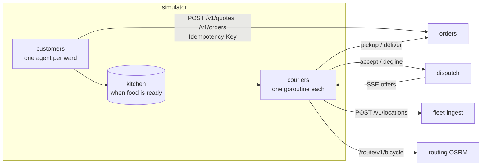

# simulator: the city

Tasuki is fictional, so something has to play Tokyo. The simulator runs merchants, customers and
couriers across the 23 wards and drives the platform **only through its public HTTP APIs**
([contracts/README.md](../../contracts/README.md)), exactly as real apps would. It never touches a
database or Kafka directly. It has two jobs:

- **Load generator** for the SLOs, load tests and game days ([docs/design.md](../../docs/design.md) §4, §9, §10).
  Scenarios are deterministic, so runs can be compared.
- **The demo**: couriers riding real Tokyo streets (OSRM, [services/routing](../routing)) on the
  live map.

It is a service like the others: `/healthz`, `/readyz`, `/metrics`, JSON logs, graceful shutdown,
distroless non-root image.

## How it works



**Seeding.** On start (or with `simulator seed`) it creates merchants and their stores through
`POST /v1/admin/merchants`, and couriers through `POST /v1/admin/couriers`, using `ADMIN_TOKEN`.
Stores sit within 800 m of each ward centre, at deterministic positions derived from the seed.
They are dealt out to the merchants in turn. Courier JWTs stay in memory, and tokens close to
expiry are re-issued through `POST /v1/admin/couriers/{id}/token`.

**Customers** (`internal/customer`). Each ward's orders arrive as a *non-homogeneous Poisson
process*: independent customers whose rate follows the scenario's time-of-day curve × the
weather × the ward's share of demand. Arrival times come from *thinning* (Lewis & Shedler, 1979):
candidates are proposed at the curve's peak rate and each is kept with probability
`rate(t) / peak`. Each order:

1. picks a store in the ward and a drop-off spread evenly within `ward_radius_m` of the ward
   centre, clamped to the 23-ward box;
2. `POST /v1/quotes` with synthetic, obviously fake customer details;
3. `POST /v1/orders` with a fresh random `Idempotency-Key`. On a timeout, 429 or 5xx it retries
   **with the same key and body**, up to 4 attempts with jittered exponential backoff,
   honouring `Retry-After`. If the first attempt committed but its answer was lost, the retry
   gets the original order back (`Idempotent-Replayed: true`, counted in
   `simulator_orders_replayed_total`). 4xx answers are not retried.

The load is **open-loop**: orders go out when they are due, not when the previous one has
finished, so a slow API shows up as latency instead of quietly lowering the load.
`demand.max_in_flight` caps concurrent orders; anything over the cap fails with reason
`backpressure`.

**Couriers** (`internal/courier`) are small state machines, one goroutine each:

```
offline ──shift starts──▶ idle ──accepts offer──▶ to_store ──arrives──▶ at_store
   ▲                       ▲                                              │ food ready → pickup
   └──shift ends (idle)────┴──────────delivered────── to_dropoff ◀────────┘
```

- **Shifts** are times of day, chosen per courier by `share`. A courier finishes the order in
  hand before logging off. In the rain, `offline_share` of the couriers on shift end it early.
- **Offers** arrive over the dispatch SSE stream (`GET /v1/couriers/me/offers/stream`, `offer` and
  `offer_cancelled` events). The stream reconnects with backoff, and also after 45 s of silence
  (the server pings every 15 s). After a short "think time", the courier accepts with
  probability `accept.probability × 0.5^(distance to store / halving_distance_m)`, otherwise
  declines. Offers arriving while busy are declined.
- **Riding**: on accept it asks OSRM for the bicycle route (`overview=full&geometries=polyline`)
  and moves along it at its vehicle speed (bicycle 15 km/h, scooter 25 km/h, × the weather's
  `speed_multiplier`). If OSRM is unavailable it rides in a straight line at the same speed
  (`simulator_routes_total{source="straight_line"}`).
- At the store it waits until the food is ready. The simulator plays the stores too, so it knows
  each order's preparation time. Then `POST /v1/courier/orders/{id}/pickup`, ride to the
  drop-off, and `POST .../deliver` with the phone's GPS reading as proof. A 404/409 means the
  order is no longer ours (cancelled or reassigned) and the courier goes back to idle.
- **GPS**: a point every 4 s with an order, every 15 s without, with Gaussian noise (`gps.noise_m`).
  Points go to `POST /v1/locations` in batches. The location path is lossy by design: on
  `503 Retry-After` the batch is **dropped** and the phone stays quiet until Retry-After has
  passed. On network errors the points are kept and resent, up to 50, dropping the oldest. On
  shutdown each courier sends a final `offline` point.

**Determinism.** Every agent has its own random source, derived from the scenario seed and the
agent's name (`courier/17/decide`, `customers/shibuya`, …), so adding a courier does not change
what the others do. Arrival times, stores, drop-offs, courier homes, vehicles and shifts are
identical on every run with the same seed. Courier decisions repeat given the same offers, but
which offers arrive depends on the live system. Idempotency keys are deliberately *not*
seeded: a re-run would otherwise get the previous run's orders back.

**Clock.** The simulated day runs at real speed, so order rates and every HTTP timestamp stay
real. `clock.start` can begin the day at a fixed time ("start at the lunch peak, whenever I run
the demo"). `clock.speedup` makes couriers ride and wait N× faster, so a 30-minute delivery
plays out in 3 minutes on the map. It affects movement and waiting only; GPS points are still
sent every 4 s of real time, just further apart.

## Running it

Built-in scenarios are compiled into the binary:

| Scenario | What it is |
|---|---|
| `small` | Laptop size: Shibuya + Shinjuku, 50 couriers, ~2 orders/min at lunch, 10× courier speed, starts at 11:00 |
| `normal-weekday` | All 23 wards at one-tenth of the design scale: ~5,200 orders/day, 600/h peak, 400 couriers on shifts |
| `rainy-friday` | `normal-weekday`'s city, starting 11:00: rain from 11:30 triples demand, couriers 15 % slower, 10 % log off |

```bash
# Against the local stack (make up), with ADMIN_TOKEN from your .env:
make sim-run                                     # small.yaml, probes/metrics on :8090
# or directly:
cd services/simulator
ADMIN_TOKEN=... go run ./cmd/simulator run -scenario rainy-friday -duration 2h
go run ./cmd/simulator validate                  # check all built-in scenarios
go run ./cmd/simulator seed -scenario small      # only seed, write the state file

# In a container:
docker run --rm -e ADMIN_TOKEN=... -e ORDERS_URL=http://orders:8000 ... \
  ghcr.io/codewithmuh/tasuki-delivery-platform/simulator run -scenario normal-weekday
```

`-scenario` takes a built-in name or a path to your own YAML file. `-seed N` overrides the
scenario's seed, `-duration` overrides how long it runs, and `-fresh` forces new merchants and
couriers.

### Configuration (environment)

| Variable | Default | Meaning |
|---|---|---|
| `ORDERS_URL` | `http://127.0.0.1:8000` | orders service |
| `FLEET_INGEST_URL` | `http://127.0.0.1:8081` | fleet-ingest |
| `DISPATCH_URL` | `http://127.0.0.1:8082` | dispatch |
| `ROUTING_URL` | `http://127.0.0.1:5000` | OSRM; `none` = straight lines only |
| `ADMIN_TOKEN` | (none) | Bearer token for `/v1/admin/*`; needed to seed and to re-issue tokens |
| `PORT` | `8080` | probes and metrics |
| `STATE_FILE` | `.state/simulator-state.json` (image: `/tmp/simulator/state.json`) | seeded keys and tokens |
| `DRAIN_TIMEOUT` | `60s` | after SIGTERM, how long couriers may finish deliveries in hand |
| `SHUTDOWN_TIMEOUT` | `20s` | HTTP server drain |
| `SEED_WAIT` | `2m` | how long to wait for orders `/readyz` before seeding |
| `SCENARIO` | `small` | default for `-scenario` |
| `LOG_LEVEL` | `info` | `debug` logs every order, offer and delivery |

### The state file (re-running a scenario)

The orders service shows a merchant's API key and a courier's token **only once**, so a restart
cannot look them up again. The simulator therefore saves what it seeded to `STATE_FILE` (mode
0600, git-ignored, never logged). A later run reuses it if its fingerprint matches: same
scenario name, seed, wards, counts and `ORDERS_URL`. Otherwise it seeds again, with a random
tag in the names so a second seeding never collides with the first. Tolerating "already
exists" conflicts was rejected because it cannot recover the lost keys. After wiping the local
database, delete the file or pass `-fresh`.

## Scenario format

Every field except `name`, `wards` and `demand.curve` has a default. Unknown fields are errors.
Times of day are quoted `"HH:MM"` in Tokyo time, and `"24:00"` means the end of the day.

| Field | Default | Meaning |
|---|---|---|
| `name`, `description` | (none) | identification; `name` is part of the state-file fingerprint |
| `seed` | 0 | root of every random choice |
| `duration` | `0s` | stop after this long; 0 = until SIGTERM |
| `clock.start` | real time | simulated time of day at start |
| `clock.speedup` | 1 | courier movement and waiting N× faster (1–1000) |
| `wards` | (none) | ward IDs from [contracts/data/wards.json](../../contracts/data/wards.json) |
| `ward_weights` | 1 each | relative demand per ward (also where couriers live) |
| `ward_radius_m` | 1500 | drop-offs, courier homes (and stores, max 800 m) around each centre |
| `merchants`, `stores_per_ward` | 1, 3 | stores are dealt out to merchants in turn |
| `couriers.count`, `scooter_share` | 0, 0 | fleet size and mix |
| `couriers.bicycle_kmh`, `scooter_kmh` | 15, 25 | dry-weather speeds |
| `couriers.shifts[]` | 00:00–24:00 | `{start, end, share}`; each courier gets one, weighted by share |
| `couriers.accept` | 0.95, 2000 m | `probability` for a store next door, halving every `halving_distance_m` |
| `couriers.think_time` | 2–8 s | time to answer an offer |
| `demand.curve[]` | (none) | `{at, per_hour}`: orders/h for the whole area, linear between points, wrapping at midnight |
| `demand.prep_time` | 5–15 min | food preparation, from order creation (divided by `speedup`) |
| `demand.max_in_flight` | 200 | concurrent order requests before `backpressure` |
| `weather[]` | none | `{name, from, to, demand_multiplier, speed_multiplier, offline_share}`, repeated daily; overlaps multiply |
| `gps.moving_interval`, `idle_interval`, `noise_m` | 4 s, 15 s, 0 | phone GPS behaviour |

## Observability

Probes: `/healthz` (always 200 while the process runs), `/readyz` (200 once seeded and running;
503 while seeding and draining) and `/metrics`. Logs are JSON lines on stdout. Every outgoing
request carries a fresh `X-Request-Id`, and failures are logged with the idempotency key, so a
failed order can be found in the orders service's logs.

| Metric | Labels | What it shows |
|---|---|---|
| `simulator_orders_attempted_total` / `_created_total` | `ward` | orders tried / confirmed |
| `simulator_orders_failed_total` | `stage` (quote, order), `reason` (`http_503`, `timeout`, `network`, `backpressure`, …) | why orders failed |
| `simulator_orders_replayed_total` | | idempotent replays after a retry |
| `simulator_client_request_duration_seconds` | `call`, `outcome` (status or `timeout`/`network`) | every call's latency **as the client saw it**; buckets around the 300 ms SLO |
| `simulator_request_retries_total` | `call` | retries |
| `simulator_location_batches_total` | `result` (sent, shed, failed, rejected) | GPS batches |
| `simulator_location_points_total` | `result` (accepted, dropped, lost) | GPS points |
| `simulator_offers_total` | `outcome` (received, accepted, declined, lost, failed, cancelled) | dispatch offers |
| `simulator_deliveries_completed_total` | | deliveries |
| `simulator_jobs_abandoned_total` | `reason` | accepted jobs given up |
| `simulator_couriers_active`, `simulator_couriers` | `state` | couriers online, by state |
| `simulator_routes_total` | `source` (osrm, straight_line) | OSRM health as couriers see it |
| `simulator_demand_orders_per_hour` | `ward` | the scenario's intended rate, to plot against what the API accepted |

**Shutdown.** On SIGTERM `/readyz` turns 503 and customers stop placing orders, though orders
already in flight finish. Couriers decline new offers, finish the delivery in hand within
`DRAIN_TIMEOUT` and send an `offline` point. Then the HTTP server drains. Orders still mid-delivery
after the timeout stay `assigned` / `picked_up` in the orders service. The next run does not
resume them.

## Development

```bash
make sim-lint    # gofmt, go vet, golangci-lint (same config as api-go)
make sim-test    # go test -race -cover ./...   (CI gate: 80 % total)
```

The courier and customer tests run inside `testing/synctest` bubbles, so whole deliveries and
hours of demand play out in milliseconds on a fake clock. HTTP clients are tested against
`httptest` servers. `internal/sim` runs the whole simulator against an in-process fake of
orders, dispatch, fleet-ingest and OSRM. `internal/scenario/wards.json` is a copy of the
contract file, and a test fails if they drift.

| Package | Responsibility |
|---|---|
| `cmd/simulator` | subcommands `run`, `seed`, `validate`, `healthcheck`, `version` |
| `scenarios/` | built-in scenario YAML (embedded) |
| `internal/scenario` | YAML parsing, defaults, validation, ward reference data |
| `internal/demand` | demand curve, weather, Poisson arrivals (thinning) |
| `internal/clock` | real time ↔ simulated time of day (JST), speed-up |
| `internal/geo` | haversine, bearings, polyline decoding, movement along a route |
| `internal/rng` | one seeded random source per agent |
| `internal/clients` | typed HTTP clients: orders, fleet-ingest, dispatch (+ SSE), OSRM; retries |
| `internal/courier`, `internal/customer` | the agents |
| `internal/sim` | seeding, state file, token refresh, orchestration, probes |
| `internal/metrics` | Prometheus metrics |
